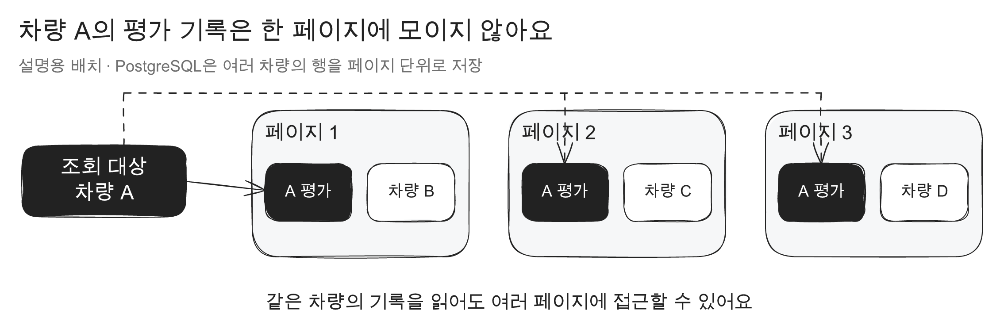
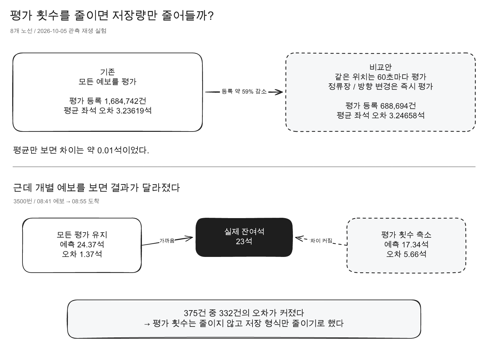

연어버스는 버스가 다음 정류장에 도착할 때 몇 석이 남을지 예측한다.
버스가 지나간 뒤 실제 잔여석과 비교하는 일을 팀에서는 **정산**이라고 불렀다.

[앞 글에서는 오래된 정산 결과를 S3로 옮기고 DB 원본을 지웠다](https://korogoo.site/salmonbus-s3-migration-verification-recovery).
그런데 새 결과가 지워지는 속도보다 더 빨리 쌓이고 있었다.

## 초당 112건씩 쌓이고 6건씩 지워지면, DB 저장 공간은 또 바닥나지 않을까?

10월 22일 08:55(한국 시간), 운영 Grafana에서 직전 15분을 봤다.
정산 완료 결과는 DB에 **초당 약 112.3건** 들어왔고,
S3로 옮긴 뒤 지워진 결과는 **초당 약 6.2건**이었다.

`forecast_evaluation_result`에는 살아 있는 행이 약 **8,405만 건**으로 추정됐다.
테이블이 **10.99GB**, 인덱스가 **7.71GB**를 쓰고 있었다.

차량 상태를 한 번 수집할 때 왜 결과가 여러 건 생길까?

```text
차량 상태 관측
→ 앞으로 갈 정류장마다 잔여석 예보
→ 실제 도착 뒤 예보와 실제 잔여석 비교
→ 정산 결과를 당일 보정과 승하차 통계에 반영
→ 오래된 결과를 S3로 옮기고 DB 원본 삭제
```

차량 한 대의 상태를 새로 받을 때마다 여러 정류장에 대한 예보를 만든다.
버스가 실제로 지나간 뒤에는 예보마다 정산 결과를 남긴다.
같은 차량의 결과가 반복해서 쌓이는 구조다.



PostgreSQL은 행을 페이지에 나눠 저장하고, 찾기 위한 인덱스와 변경 기록인 WAL도 갱신한다.
행을 지워도 파일 크기가 곧바로 줄어들지는 않는다.
일반적인 vacuum은 지운 공간을 같은 테이블에서 다시 쓸 수 있게 정리한다. ([PostgreSQL 문서](https://www.postgresql.org/docs/current/sql-vacuum.html))

그러면 어디부터 줄일 수 있을까?

## DB에 남기지 않아도 되는 값은 뭘까?

정산 결과를 전부 버릴 수는 없었다.
오늘 나온 결과는 뒤이어 만드는 잔여석 예보를 보정하고,
한 정류장 앞의 결과는 승하차 통계에도 쓰인다.
worker가 재시작해도 어느 예보의 정산이 끝났는지 알아야 같은 일을 반복하지 않는다.

오래된 결과는 이미 S3에 옮겨 지우고 있었다.
문제는 계속 들어오는 새 결과였다.
그럼 **정산 횟수**를 줄일 수 있을까?
아니면 정산은 전부 하되, **결과 한 건의 크기**를 줄일 수 있을까?

오래된 행을 지우는 방법도 바꿔보고,
정산 횟수와 결과 한 건의 크기도 차례로 살펴봤다.

## 오래된 레코드 30만 건을 날짜별로 통째로 지우면?

먼저 지우는 방법부터 봤다.
오래된 행을 하나씩 `DELETE`하는 대신,
날짜별로 나눈 테이블을 통째로 제거하면 어떨까?
이 날짜별 테이블을 **파티션**이라고 한다.

PostgreSQL 18에 운영과 같은 테이블 구조와 인덱스를 만들고,
60만 행을 넣은 뒤 오래된 30만 행을 지웠다.
CPU 1개, 메모리 512MiB에서 세 번 실행해 가운데 값을 적었다.

| 항목                    | `DELETE` | 날짜 파티션 `DROP` |
| ----------------------- | -------: | -----------------: |
| 제거 시간               |  0.162초 |            0.042초 |
| 제거 구간 WAL           |  71.27MB |            0.056MB |
| 이후 vacuum WAL         |  21.28MB |                0MB |
| 제거 후 테이블과 인덱스 | 147.25MB |            73.77MB |

30만 행을 제거하는 데 걸린 시간은 약 4분의 1이었다.
제거 구간의 WAL도 훨씬 적었다.

근데 기존 테이블은 `(vehicle_observation_id, target_stop_order)`를 유일한 키로 써서
같은 예보의 결과가 두 번 들어오지 않게 막는다.
날짜로 파티션을 나누려면 유일성 제약에도 그 날짜를 포함하거나
중복을 막는 구조를 따로 만들어야 한다. ([PostgreSQL 파티션 제약](https://www.postgresql.org/docs/current/ddl-partitioning.html))

`evaluation_archive_member`가 정산 원본을 가리키는 외래 키도 함께 바꿔야 했다.
그리고 파티션을 빨리 지워도 S3로 옮기는 worker가 한 번에 최대 100행씩 고르는 흐름은 그대로다.

삭제 비용은 줄일 수 있지만, 새 결과가 쌓이는 양까지 바뀌지는 않았다.
그래서 이번에는 **만드는 행 수**를 줄여봤다.

## 정확도를 위한 정산을 줄여도 될까?

기존 8개 노선의 10월 5일 관측을 시간순으로 다시 처리했다.
모든 예보를 정산하는 대신 아래 조건에 맞을 때만 정산했다.

- 같은 차량은 마지막 정산에서 60초가 지났을 때
- 60초 전이라도 정류장이나 방향이 바뀌었을 때
- 승하차 통계에 쓰는 한 정류장 앞 예보일 때

정산 대상으로 등록한 예보는 **1,684,742건에서 688,694건**으로 **59.12%** 줄었다.
평균 좌석 오차는 **3.23619석에서 3.24658석**으로 **0.01039석** 늘었다.



이 정도면 정산을 줄여도 되겠다는 생각이 들었다.
그런데 평균만 보면 많이 달라진 예보가 가려진다.
두 방식의 예측 잔여석이 3석 넘게 다른 사례를 꺼내봤다.

### 3500번 버스는 왜 실제 23석을 17석으로 예측했지?

10월 5일 08:41에 만든 3500번 버스의 예보다.
08:55에 버스가 도착했을 때 실제 잔여석은 **23석**이었다.

| 방식           | 예측 잔여석 | 실제와의 차이 | 보정 후 만석 확률 |
| -------------- | ----------: | ------------: | ----------------: |
| 모든 예보 정산 |     24.37석 |        1.37석 |            26.46% |
| 정산 횟수 축소 |     17.34석 |        5.66석 |            47.67% |

예보에 쓸 모델과 차량 관측은 같았다.
달라진 건 그날 앞서 정산해 둔 결과였다.

당일 보정은 실제로 맞고 틀린 결과를 보고 이후 예보의 만석 확률을 조정한다.
같은 날, 같은 노선, 같은 예측 거리에서 쓸 수 있는 정산 결과가
**2,800건에서 989건**으로 줄었다. 두 방식 모두 실제 만석 관측은 0건이었다.

보정 로직은 정산 결과가 50건 이상일 때 움직이고,
결과가 적을 때 확률이 급하게 바뀌지 않도록 기존 평균 확률에 200건의 가상 표본을 더한다.

```text
보정에 쓰는 만석 비율
= (실제 만석 건수 + 200 × 기존 평균 만석 확률)
  / (실제 정산 건수 + 200)
```

정산 건수가 줄자 실제로 쌓인 **‘만석 아님’**보다
기존 평균 확률의 영향이 커졌다.
그래서 만석 확률이 **26.46%에서 47.67%**로 올라갔고,
예측 잔여석은 **24.37석에서 17.34석**으로 내려갔다.

3석 넘게 달라진 예보 375건 중 332건은 실제 좌석 수와의 차이도 커졌다.
평균 오차 0.01석만 봤다면 이 사례를 놓칠 뻔했다.
**정산 횟수를 줄이는 방법은 쓰지 않기로 했다.**

## 원본 관측에 있는 값을 정산 결과에 또 저장해야 할까?

정산은 전부 하기로 했다.
그럼 결과를 저장할 때도 차량 ID와 도착 정류장 정보를 매번 다시 적어야 할까?

원본 차량 관측에는 차량 ID, 지나간 정류장과 노선 판본이 있다.
정산 결과에는 이 원본을 다시 찾을 수 있는 ID가 남는다.
정상적으로 끝난 정산이라면 원본에서 다시 읽을 수 있는 값을
결과마다 반복해서 저장하지 않아도 된다.

모든 결과를 작게 저장할 수는 없었다.
아래 경우는 나중에 결과를 살펴보거나 통계를 다시 계산할 때 필요한 정보가 달라서
기존처럼 상세하게 남겼다.

- 처음 본 차량이거나 마지막 상세 저장에서 60초가 지난 경우
- 정류장, 방향, 노선 판본 또는 모델이 바뀐 경우
- 승하차 통계에 쓰는 한 정류장 앞 예보
- 방향을 알 수 없거나 과거 관측을 다시 처리한 경우
- 건너뜀, 도착 미확인, 좌석 정보 없음, 품질 제외처럼 정상 정산이 아닌 경우

그 외 정상 결과에는 예보를 찾는 키, 도착 관측 ID, 실제 잔여석,
정산 시각, 도착 시각과 당시 운행 키만 남겼다.
이 결과는 `forecast_evaluation_compact`에 저장한다.

```text
모든 예보 정산
→ 상세 조건에 해당: 기존 상세 결과 테이블
→ 그 외 정상 결과: 최소 결과 테이블
```

기존 조회는 상세 결과와 최소 결과를 `UNION ALL`로 합친 뷰에서 읽도록 했다.
뷰는 두 테이블을 한 조회 대상으로 보여준다.
승하차 통계에 쓰는 한 정류장 앞 결과는 상세 테이블만 읽도록 분리했다.
매번 최소 결과까지 원본 관측과 연결해 읽는 비용을 피하기 위해서다.

최소 결과는 도착 관측을 외래 키로 가리킨다.
도착 관측이 먼저 지워져 최소 결과를 읽지 못하는 일을 막는다.
정산 결과를 합계로만 메모리에 들고 있으면 worker 재시작 뒤
어느 예보를 처리했는지 다시 판단하기도 어렵다.
그래서 최소한의 결과는 DB에 남겼다.

## 정산은 그대로 했는데, DB 공간은 얼마나 줄었을까?

같은 10월 5일 관측과 같은 모델로 다시 처리했다.
이번에는 **1,684,742건을 모두 정산**하고 저장 형식만 나눴다.

| 확인한 값                   | 모두 상세 저장 | 상세와 최소 저장 분리 |
| --------------------------- | -------------: | --------------------: |
| 비교한 예보                 |    1,684,742건 |           1,684,742건 |
| 확률 분포가 달라진 예보     |           기준 |                   0건 |
| 평균 좌석 오차              |      3.23619석 |             3.23619석 |
| 정상 정산 중 상세 저장 대상 |    1,411,497건 |             586,954건 |

예측 분포가 달라진 건 **0건**이었다.
3500번 버스도 다시 **24.37석**으로 예측했다.
정상 정산 중 자세히 저장할 대상은 **58.42%** 줄었다.

그럼 DB에서 차지하는 크기도 그만큼 줄었을까?
PostgreSQL 18에 결과 10만 행을 넣고 두 저장 방식을 비교했다.

| 저장 방식                     | 테이블과 인덱스 크기 |
| ----------------------------- | -------------------: |
| 모두 상세 저장                |     27,910,144바이트 |
| 상세 41,584건과 최소 58,416건 |     20,316,160바이트 |

테이블과 인덱스를 합치면 **27.21%** 작았다.
최소 결과에도 기본 키, 외래 키와 도착 시각 인덱스가 필요했다.
그래서 상세 저장 대상이 줄어든 비율과 전체 크기가 줄어든 비율은 달랐다.

정산 횟수는 그대로 두고, 원본에서 다시 읽을 수 있는 값만 결과 저장에서 뺐다.
