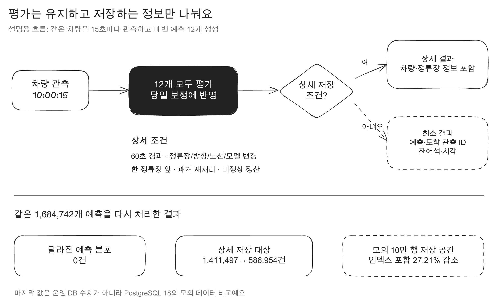

Salmonbus는 버스가 정류장에 도착했을 때 남은 좌석을 예측합니다. 예측이 맞았는지 나중에 평가하려면 예측값과 실제 도착 관측을 DB에 남겨야 합니다.

이 평가 결과를 S3로 옮긴 뒤 DB에서 지우고 있었는데, **삭제하는 속도보다 새 결과가 들어오는 속도가 더 빨랐습니다.** 2026년 10월 22일 08:55 KST Grafana를 기준으로 직전 15분 동안 `forecast_evaluation_result`에는 초당 약 112건이 들어왔고, 삭제는 초당 약 6.2건이었습니다. 추정 생존 행은 약 8,405만 건이었고 테이블은 10.99GB, 인덱스는 7.71GB를 차지했습니다.

저장량만 보면 평가 횟수를 줄이는 게 가장 단순해 보였습니다. 근데 평가 결과는 보관용 이력이 아니었습니다. 당일 예측을 보정하고 승하차 통계를 다시 계산하는 입력이기도 했습니다.

결국 줄여도 되는 것은 평가가 아니라, 원본 관측에서 다시 읽을 수 있는 중복 정보였습니다.

## 삭제하고 있는데도 왜 계속 쌓였나

평가 결과가 만들어지는 흐름은 다음과 같습니다.

```text
15초마다 차량 관측 저장
→ 차량별 여러 도착 정류장의 잔여석 예측
→ 실제 도착 관측과 연결해 예측 평가
→ 평가 결과를 당일 보정과 승하차 통계에 반영
→ 오래된 상세 결과를 S3에 보관한 뒤 DB에서 삭제
```

한 번 관측한 차량에서 여러 정류장 예측이 만들어집니다. 관측 주기는 짧고 노선과 차량은 함께 처리하기 때문에 같은 차량의 기록도 여러 DB 페이지에 나뉘어 저장됩니다.


PostgreSQL은 행을 저장할 때 테이블 페이지만 쓰지 않습니다. 기본 키와 보조 인덱스도 갱신하고, 장애 복구와 복제를 위한 WAL도 기록합니다. 행을 `DELETE`해도 파일에서 즉시 사라지지 않습니다. 삭제된 행은 dead tuple로 남고 vacuum이 다시 쓸 수 있는 공간으로 정리합니다.

그래서 문제를 세 가지로 나눠봤습니다.

1. 오래된 행을 지우는 비용이 큼
2. S3 이관 worker가 한 번에 처리하는 양이 작음
3. 평가 결과 한 행에 원본 관측과 겹치는 값이 반복됨

삭제만 빠르게 만들어도 새로 쌓이는 양이 그대로면 다시 같은 문제가 생깁니다. 반대로 저장만 줄여도 이미 쌓인 데이터는 없어지지 않습니다. 이관 처리량과 새 데이터의 저장 구조를 같이 봐야 했습니다.

## 첫 번째 시도: 날짜 파티션으로 오래된 데이터를 지우기

먼저 오래된 행을 하나씩 삭제하지 않고 날짜 파티션을 통째로 제거하는 방법을 비교했습니다.

PostgreSQL 18 로컬 컨테이너에 같은 스키마와 인덱스로 합성 데이터 60만 행을 만들고, 오래된 30만 행을 지웠습니다. CPU 1개, 메모리 512MiB 조건에서 세 번 실행한 중앙값입니다.

| 항목                    | `DELETE` | 날짜 파티션 `DROP` |
| ----------------------- | -------: | -----------------: |
| 제거 시간               |  0.162초 |            0.042초 |
| 제거 구간 WAL           |  71.27MB |            0.056MB |
| 이후 vacuum WAL         |  21.28MB |                0MB |
| 제거 후 테이블과 인덱스 | 147.25MB |            73.77MB |

파티션 제거는 빠르고 WAL도 적었습니다. 하지만 현재 중복 방지는 `(vehicle_observation_id, target_stop_order)` 유일성에 의존합니다. PostgreSQL에서 날짜 파티션을 사용하려면 이 키에 파티션 날짜를 포함하거나 별도의 중복 방지 구조가 필요했습니다.

`evaluation_archive_member`가 예측 원본을 외래 키로 참조하는 조건도 같이 바꿔야 했습니다. 파티션만 추가하는 변경으로 끝나지 않았고, S3 업로드가 100행씩 처리되는 병목도 해결하지 못했습니다. 바로 적용하기보다 저장 구조부터 다시 보기로 했습니다.

## 두 번째 시도: 평가 횟수 자체를 줄이기

기존 8개 노선의 2026년 10월 5일 관측을 시간순으로 다시 재생했습니다. 같은 차량은 마지막 평가 후 60초가 지났거나 정류장과 방향이 바뀌었을 때만 새 평가를 등록했습니다. 승하차 통계에 쓰는 한 정류장 앞 예보는 모두 유지했습니다.

평가 등록은 `1,684,742건`에서 `688,694건`으로 59.12% 줄었습니다. 평균 좌석 오차는 `3.23619석`에서 `3.24658석`으로 0.01039석 늘었습니다.


평균 오차만 보면 적용할 수 있는 차이처럼 보였습니다. 그래서 두 방식의 예측값이 3석 넘게 달라진 사례를 따로 확인했습니다.

3500번 노선의 08:41 예측은 08:55 도착 관측에서 잔여석 23석으로 확인됐습니다.

| 방식           | 예측 잔여석 | 절대 오차 | 보정 후 만석 확률 |
| -------------- | ----------: | --------: | ----------------: |
| 모든 평가 유지 |     24.37석 |    1.37석 |            26.46% |
| 평가 횟수 축소 |     17.34석 |    5.66석 |            47.67% |

차이는 당일 보정에서 생겼습니다. 같은 날, 같은 노선, 같은 예측 거리의 정산 표본이 2,800건에서 989건으로 줄었습니다. 두 방식 모두 만석 관측은 0건이었지만, 표본이 적어진 쪽은 “오늘 이 노선은 실제로 만석이 아니었다”는 결과를 덜 반영했습니다.

보정 로직은 표본이 50건 이상일 때 동작하고, 적은 표본 하나가 확률을 크게 바꾸지 않도록 평균 확률에 200건의 가상 표본을 더합니다.

```text
보정에 쓰는 만석 비율
= (실제 만석 건수 + 200 × 기존 평균 만석 확률)
  / (실제 정산 건수 + 200)
```

실제 정산 건수가 줄면 200건의 비중이 커집니다. 평가를 줄인 쪽은 그날 쌓인 “만석 아님” 결과보다 기존 평균을 더 많이 따랐고, 만석 확률이 충분히 내려가지 않았습니다. 그 결과 예상 잔여석도 낮아졌습니다.

3석 넘게 달라진 예측 375건 중 332건은 실제 오차가 커졌습니다. 평균 오차 하나만 봤다면 놓쳤을 결과였습니다. **평가 횟수와 당일 보정 입력을 같이 줄이는 방식은 사용하지 않기로 했습니다.**

## 세 번째 시도: 평가는 유지하고 저장 표현을 나누기

예측 정확도에 필요한 정산은 모두 유지했습니다. 대신 결과를 상세 기록과 최소 기록으로 나눴습니다.

다음 결과는 기존 상세 형식으로 저장합니다.

- 처음 본 차량이거나 마지막 상세 저장 후 60초가 지난 경우
- 정류장, 방향, 노선 판본, 모델이 바뀐 경우
- 승하차 통계에 쓰는 한 정류장 앞 예측
- 방향을 알 수 없거나 과거 관측을 다시 처리한 경우
- 건너뜀, 도착 미확인, 좌석 정보 없음, 품질 제외처럼 정상 정산이 아닌 경우

그 외 정상 결과는 `forecast_evaluation_compact`에 저장합니다. 예측 키, 도착 관측 ID, 실제 잔여석, 정산 시각, 도착 시각과 당시 운행 키만 남깁니다. 차량 ID, 도착 정류장, 노선 판본처럼 원본 관측에서 읽을 수 있는 값은 다시 저장하지 않습니다.



조회 쪽에서는 상세 테이블과 최소 테이블을 `UNION ALL`한 뷰를 사용합니다. 최소 결과는 도착 관측을 외래 키로 참조해서 다시 읽을 값이 먼저 삭제되지 않도록 했습니다. 한 정류장 앞 통계는 상세 결과만 읽는 별도 뷰로 분리했습니다. 통계 조회가 매번 최소 결과 전체와 원본 관측을 조인하지 않게 하려는 선택이었습니다.

같은 차량이 같은 정류장에 있고 15초마다 12개 예측을 만든다는 설명용 예시는 다음과 같습니다.

| 관측 시각 | 정산 대상 | 상세 저장 | 최소 저장 |
| --------- | --------: | --------: | --------: |
| 10:00:00  |      12개 |      12개 |       0개 |
| 10:00:15  |      12개 |       1개 |      11개 |
| 10:00:30  |      12개 |       1개 |      11개 |
| 10:00:45  |      12개 |       1개 |      11개 |
| 10:01:00  |      12개 |      12개 |       0개 |

합계만 메모리에 남기는 방식도 생각했습니다. 저장 공간은 더 줄어들지만 worker가 재시작되면 집계 근거를 다시 만들 수 없습니다. 같은 평가가 두 번 반영되지 않게 판단할 키도 필요했습니다. 그래서 재계산과 중복 방지에 필요한 최소 결과는 DB에 남겼습니다.

## 정확성부터 고정하고 저장 비용을 비교했다

최종 방식으로 같은 관측과 모델을 다시 재생했습니다. 모든 정산 결과를 당일 보정과 승하차 통계에 넣고, 상세 저장 여부만 분리했습니다.

| 확인한 값                  | 기존 전체 저장 | 상세와 최소 저장 분리 |
| -------------------------- | -------------: | --------------------: |
| 생성한 예측                |    1,684,742건 |           1,684,742건 |
| 확률 분포가 달라진 예측    |           기준 |                   0건 |
| 평균 좌석 오차             |      3.23619석 |             3.23619석 |
| 정상 정산의 상세 저장 대상 |    1,411,497건 |             586,954건 |

앞에서 오차가 커졌던 3500번 예측도 다시 24.37석이 됐습니다. 정확도 입력을 모두 유지하면 상세 저장 대상을 58.42% 줄여도 같은 예측을 만들 수 있었습니다.

저장 바이트는 PostgreSQL 18에 모의 데이터 10만 행을 넣어 비교했습니다.

| 저장 방식                     | 테이블과 인덱스 크기 |
| ----------------------------- | -------------------: |
| 모두 상세 저장                |     27,910,144바이트 |
| 상세 41,584건 + 최소 58,416건 |     20,316,160바이트 |

인덱스를 포함해 27.21% 줄었습니다. 행 수와 저장 바이트가 같은 비율로 줄지 않는다는 점도 같이 확인했습니다. 최소 테이블에도 기본 키, 외래 키와 도착 시각 인덱스가 필요하기 때문입니다.

## 운영 지표로 이관 병목을 다시 봤다

로컬 재생 결과만으로 운영 효과를 판단하지 않았습니다. Grafana의 PostgreSQL 지표와 worker 로그를 같은 시간대로 확인했습니다.

2026년 10월 22일 08:40부터 08:55 KST까지 worker는 74번의 이관 묶음에서 5,304행을 삭제했습니다. 묶음당 평균 약 71.7행이었고 최대 100행이었습니다. 성공한 묶음의 평균 처리 시간은 약 5.33초, 95백분위는 약 5.63초였습니다. 같은 15분 동안 실패 로그도 3건 있었습니다.

| Grafana에서 본 값                         | 08:55 KST 기준 |
| ----------------------------------------- | -------------: |
| 평가 결과 입력 속도, 직전 15분 평균       |  약 112.3행/초 |
| 평가 결과 삭제 속도, 직전 15분 평균       |    약 6.2행/초 |
| `forecast_evaluation_result` 추정 생존 행 |  약 8,405만 행 |
| 테이블 크기                               |        10.99GB |
| 인덱스 크기                               |         7.71GB |
| 대기 중인 DB 잠금 연결                    |            0개 |

잠금 대기는 없었지만 입력과 삭제의 차이가 컸습니다. 쿼리 하나가 느려서 멈춘 문제가 아니라, 100행 단위 이관과 5초 간격으로는 새 평가 결과의 증가량을 따라가기 어려운 상태였습니다.

그래서 이관 코드는 한 번에 500행을 읽도록 늘리고, 4MiB 파일 크기와 SQL 제한 시간 안에서 최대 1,000행까지 처리할 수 있게 만들었습니다. 10월 22일 Grafana에서 관측한 운영 worker의 묶음 상한은 100행이었기 때문에, 500행 확대 수치는 운영 성과에 넣지 않았습니다. 운영에서는 다음 값을 함께 봅니다.

- 평가 결과의 초당 입력과 삭제
- 이관 묶음의 행 수, 처리 시간, 실패 건수
- 상세 테이블과 최소 테이블의 생존 행, 테이블 크기, 인덱스 크기
- WAL 생성량, dead tuple, autovacuum, 잠금 대기

저장 구조를 나눈 뒤에도 삭제 속도 하나만 보면 원인을 놓칠 수 있습니다. 상세 테이블이 줄어도 최소 테이블이 같은 속도로 커지거나, 인덱스와 WAL이 예상보다 많이 늘 수 있기 때문입니다.

## 줄인 것은 평가가 아니라 중복 정보였다

처음에는 평가 건수를 59% 줄이면 저장 문제도 같이 풀릴 거라고 생각했습니다. 실제로 평균 오차 차이는 0.01석 정도였습니다. 하지만 개별 예측과 당일 보정 흐름을 따라가 보니 정확도 입력까지 바꾸고 있었습니다.

최종 구조에서는 `1,684,742건`의 평가를 그대로 처리했고 확률 분포가 달라진 예측은 0건이었습니다. 대신 정상 정산의 상세 저장 대상을 58.42% 줄였고, 10만 행 저장 실험에서는 테이블과 인덱스 크기가 27.21% 줄었습니다.

이 작업에서 지킨 기준은 하나였습니다. **예측을 만드는 데이터 계약은 유지하고, 다른 원본에서 다시 읽을 수 있는 값만 덜 저장했습니다.**

구현과 실험 조건은 [PR #141](https://github.com/woowacourse-teams/2026-salmonbus/pull/141)에 남겼습니다.

[평가 축소 실험 Excalidraw 원본](assets/salmonbus-portfolio/excalidraw/evaluation-sampling-experiment.excalidraw)

[상세 저장 분기 Excalidraw 원본](assets/salmonbus-portfolio/excalidraw/evaluation-storage-decision.excalidraw)
