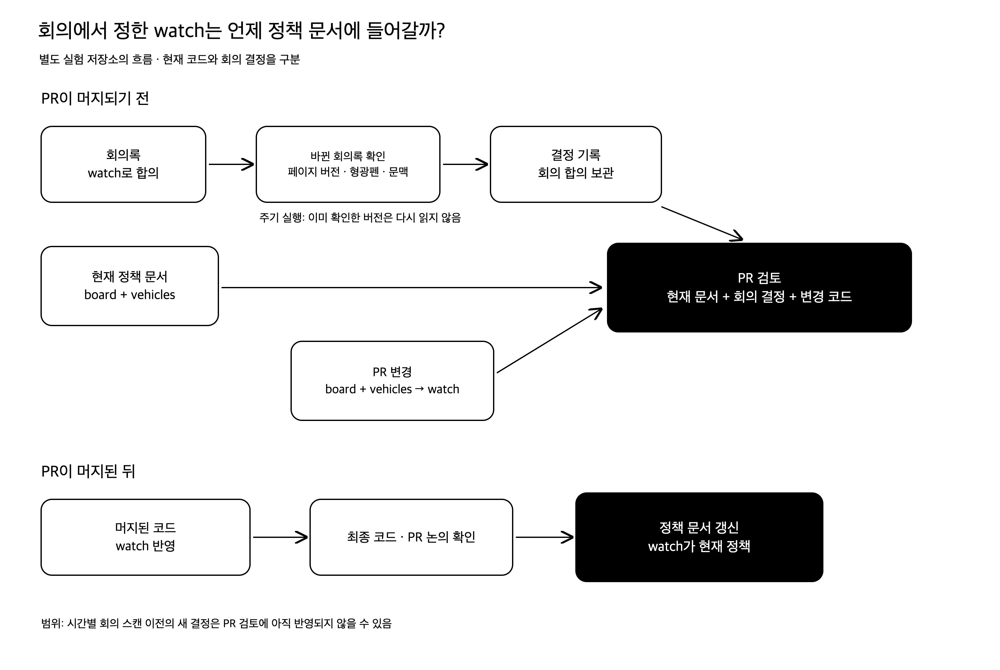

## '아 우리가 저번에 이렇게 하기로 했나?'

우리 팀의 규칙은 아래와 같다.

1. 코드 변경 사항은 PR을 통해 반영한다.
2. PR은 최소 1명 이상 리뷰한다.

그런데 PR을 볼 때마다  
‘아 우리가 저번에 이렇게 하기로 했었나?’ 하는 의문이 든다거나,
팀 회의를 하다 보면  
‘아 지금 계산이 그런 규칙으로 되고 있었나요?’ 같은 질문이 나온다.

보통 그러면
‘저번 주 회의록 보면 우리가 이렇게 정했던 거 적어놨어요’ 한다거나,  
‘데이터를 수집할 때는 이렇게 되고, 그래서 계산할 때는 이렇게 되고 있어요’ 하고 다시 설명한다.

그때는 아~ 하고 이해한다.
그런데 다른 작업을 하다 보면 금방 또 까먹고 다시 질문을 하게 된다거나 아예 기억 조차 못하게 된다.

## 그럼 매번 정책을 공부했어야 했나?

처음에는 **도메인 정책을 몰라서** 이런 상황이 반복된다고 생각했다.

모르면 부분을 싹 다 공부하면 되겠다고 생각했다.
근데 그러면 회의가 끝날 때마다 회의록을 다시 읽고,
다른 사람이 바꾼 코드까지 계속 공부해야 할까?

솔직히 현실적으로 그럴 여유가 없다.

당장 내일까지 로그인을 추가해야 하고, 이틀 뒤에는 즐겨찾기 기능도 추가해야 한다.
그 사이에 다른 사람의 작업 내용을 읽고 정책이 바뀌었는지까지 계속 확인할 시간이 있을까?

심지어 오늘 공부했던 수집 규칙이 내일 수정된 코드에서는 또 달라진다.
새로운 기능이 빠르게 추가되는 초기 팀에서는 규칙이 변하는 속도를 따라잡기 어렵다.

심지어 사람의 기억력은 믿을 수도 없다!

## 그럼 필요할 때만 AI로 찾아보자!

팀 회의에서 정한 내용은 전부 Confluence 회의록에 남긴다. 그리고 중요한 내용에는 형광펜도 치고 있다.

처음에는 형광펜 친 내용만 쭉 읽어도 도메인 정책을 파악하기에 충분했다.

그런데 작업에 속도가 붙을수록 회의록이 일주일에 5~6개씩 생기기 시작했다.

회의록이 점점 쌓이다 보니까 하나씩 들어가서 **읽기가 귀찮아졌다.**

### 그럼 필요할 때만 찾아보면 되지 않을까?

궁금한 게 생기면 AI한테 Confluence 회의록과 코드를 읽히고 질문을 통해 파악했다.
“노선 추가 어떤 거 하기로 했더라?”
“지금 코드는 언제 정산하고 있어? 주기가 어떻게 돼?"

이렇게 하면 궁금한 정책은 찾을 수 있다.
근데 내가 모르는 사이에 PR이 2~3개 머지 되고, 기존에 물어봤던 정책이 바뀌었다면?

결국 언제 다시 찾아봐야 하는지는 사람이 판단해야 하기 때문에 실수할 수 있고,
심지어 이미 잘 알고 있다고 생각하는 정책들일수록 다시 확인하지 않게 된다.

## 정책 문서를 만들자

### 우선 도메인부터 정의하자

궁금할 때마다 AI한테 회의록이랑 코드를 다 읽어보라고 했다.
근데 같은 내용을 매번 다시 읽히니까 답을 찾는 데 시간도 오래 걸리고, 토큰도 낭비된다.

필요한 규칙을 빠르게 찾을 수 있게 도메인 정책을 한곳에 문서화하려고 했다.
그럼 알고 있는 내용을 쭉 적으면 될까?
예를 들어, 용어 설명 없이 정책을 나열하면 이런 식이다.

> 수집할 때는 GBIS에서 가져온 데이터를 DB에 저장한다.  
> 관측을 조회한 뒤 예보를 계산한다.  
> 정산할 때는 예보 거리별 당일 합계 증가분을 저장한다.

이게 무슨... 말인가..?

수집이랑 관측은 뭐가 다른 거지?  
예보 거리는 뭘 기준으로 잰 거리이고, 당일은 어느 날짜를 말하는 거지?

규칙을 적어놔도 '수집', '관측' 같은 도메인 용어를 모르면 다시 코드를 뒤져야 한다.
그래서 정책을 문서화 하기 전에, 도메인용어부터 정리해야 한다고 생각했다.

### 잠만,,,도메인 문서를 과연 읽을까?

열심히 작성한 도메인 규칙... 이 문서를 과연 주기적으로 찾아서 읽을까?

처음 한두 번은 '오~ 이런 걸 만들었어?' 하고 읽어보겠지만,
바쁘게 작업하다 보면 회의록을 찾아 읽던 때와 크게 다르지 않을 것이다.

우리 팀은 PR을 최소 한 명 이상 리뷰하는 것이 규칙이다.
그럼 PR을 볼 때 관련된 도메인 문서를 같이 보여주면 어떨까?

사람이 문서를 읽을 시점을 정하는 게 아니라,
필요한 순간에 도메인 문서를 손에 딱 쥐어주는 것이다.

### 잠만,,도메인 문서를 링크까지 타고 들어가서 읽을까....??

PR에 도메인 문서 링크만 달아주면 나는 절대 안 읽고 싶을 것 같다..ㅎ
결국 링크에 들어가서 문서의 어느 내용이 이번 PR과 다른지 직접 찾아야 한다.

아래처럼 알려주면 어떨까?

_실험 저장소에서 자동화가 남긴 댓글_

이런 식으로 도메인 문서를 찾아서 필요한 부분에 밑줄까지 그어 보여주면 편할 것 같다는 생각이다.

### 이게 최신 정책이라는 건 어떻게 알지?

팀 회의에서는 판정 보드가 `board`와 `vehicles`를 따로 조회하지 않고, `watch` 엔드포인트 하나로 받기로 정했다.

팀 레포와는 별도로 만든 실험 저장소에서 기존에 올라왔던 PR을 똑같이 올리면서 재현했는데, `watch`로 바꾼 부분을 **현재 팀 문서와 어긋난다고 지적했다.**

이미 `watch`에 대한 얘기는 충분히 했는데, PR에서 불필요하게 ‘이건 없는 내용이다’라는 지적이 나오는 걸 막고 싶었다.

처음에는 회의가 끝날 때마다 정책 문서를 바로 고치면 되겠다고 생각했다.

근데 회의에서 `watch`를 쓰기로 했어도, PR이 실제로 반영되기 전까지는 `board`와 `vehicles`를 호출할 것이다. 문서를 먼저 고쳐버리면 나중에 PR이 반영되지 않았을 때 다시 되돌려야 하고, 팀원들도 지금 어떤 방식으로 동작하는지 헷갈릴 수 있다.

그래서 회의에서 정한 내용은 회의록에 그대로 두고, PR을 리뷰할 때 정책 문서와 회의록의 결정 내용을 같이 읽도록 했다.

이때 회의록을 매번 처음부터 다시 읽는 낭비를 줄이기 위해서, 마지막으로 확인한 페이지 버전을 기록했다. 이후에는 바뀐 회의록의 형광펜과 앞뒤 내용만 다시 읽었다.

그리고 최종적으로 PR이 머지되면 정책 문서를 업데이트하는 방식으로 자동화했다.

