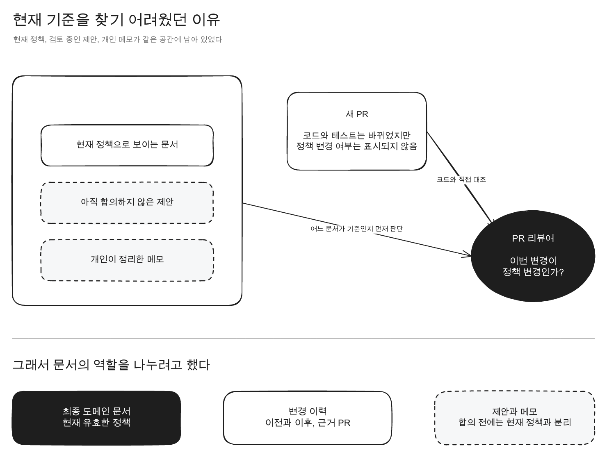
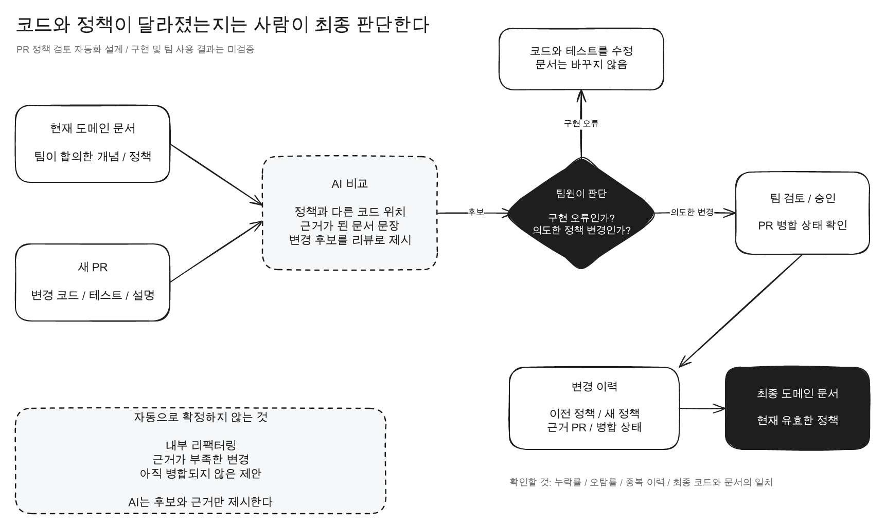

이 글은 구현을 완료한 성과가 아니라 **팀의 도메인 문서와 코드가 달라지는 순간을 찾기 위해 정리한 설계 기록**입니다. PR 자동 검토와 병합 후 문서 갱신은 아직 구현하거나 팀에서 검증하지 않았습니다.

연어버스에서는 수집, 예보, 평가, 집계 같은 용어를 프론트엔드와 백엔드가 함께 사용합니다. 근데 같은 단어를 쓰더라도 어디서 시작하고 언제 끝나는지, 실패하면 어떤 상태를 유지하는지에 대한 이해가 다를 때가 있었습니다.

Confluence에는 현재 정책, 검토 중인 제안, 개인 메모가 함께 남아 있었습니다. 코드와 문서도 따로 바뀌었습니다. 그래서 PR을 볼 때마다 이번 변경이 기존 정책과 같은지 직접 찾아서 비교해야 했습니다.

## 문서를 더 많이 쓰는 것으로는 해결되지 않았다

문서 수를 늘리면 설명은 많아지지만 지금 유효한 기준을 찾기는 더 어려워질 수 있습니다.



먼저 팀이 현재 기준으로 사용할 문서를 따로 두고, 다음 내용을 연결하려고 했습니다.

- 팀에서 사용하는 개념과 목적
- 입력과 출력
- 정상 흐름과 실패 조건
- 지금 유효한 서비스 정책
- 정책을 바꾼 PR과 결정 이유

`수집이 무엇인가요?`, `예보는 언제 만들어졌다고 보나요?`처럼 팀에서 실제로 다르게 이해할 수 있는 질문부터 정리했습니다. 클래스 설명을 모아놓는 것이 아니라, 같은 상황을 봤을 때 같은 판단을 하기 위한 기준을 남기려는 목적이었습니다.

## PR에서 정책 변경 후보를 찾는다

코드가 바뀔 때마다 사람이 모든 문서를 다시 읽는 방식은 유지하기 어렵습니다. 그래서 PR이 올라오면 AI가 변경 코드와 도메인 문서를 비교하도록 설계했습니다.

AI가 남길 결과는 결론이 아니라 검토할 후보입니다.

```text
정책과 다르게 보이는 코드 위치
근거가 된 도메인 문서 문장
왜 정책 변경 후보로 판단했는지
```

그다음 팀원이 구현 오류인지, 의도한 정책 변경인지 판단합니다.



내부 리팩터링, 근거가 부족한 변경, 아직 병합되지 않은 제안을 AI가 정책 변경으로 확정하면 안 됩니다. AI는 비교할 위치와 근거를 좁히고, 정책을 바꿀 권한은 팀에 남깁니다.

## 구현 오류와 정책 변경을 나눈다

문서와 다른 코드가 모두 잘못된 코드는 아닙니다.

- 구현 오류라면 코드와 테스트를 고치고 현재 문서는 유지
- 의도한 정책 변경이라면 팀이 이유와 영향을 검토
- 합의되지 않았다면 정책 문서를 바꾸지 않음

의도한 변경으로 승인된 PR이 병합되면 이전 정책과 새 정책, 근거 PR, 병합 상태를 변경 이력으로 남깁니다. 최종 도메인 문서에는 현재 유효한 정책만 반영합니다.

PR이 열렸다는 사실만으로 문서를 먼저 바꾸지 않는 이유는 최종 코드가 달라질 수 있기 때문입니다. 리뷰에서 구현이 수정되거나 PR이 닫힐 수도 있습니다. 문서 갱신은 팀의 승인과 실제 병합을 확인한 뒤에 실행해야 합니다.

## 알림에는 결론보다 판단 근거가 필요했다

`정책이 변경됐습니다`라는 알림만 받으면 팀원은 결국 PR과 문서를 다시 찾아야 합니다.

그래서 알림에는 최소한 다음 내용을 넣으려고 했습니다.

- 어떤 정책 문장이 바뀌었는지
- 변경 전과 변경 후 내용
- 근거가 된 코드 위치와 PR
- 누가 검토했고 병합됐는지
- 최종 문서에 반영됐는지

이력이 있으면 나중에 정책이 왜 바뀌었는지 확인할 수 있습니다. 최종 문서는 현재 기준을 읽는 용도, 변경 이력은 판단 과정을 확인하는 용도로 나눕니다.

## 구현 전에 확인해야 할 것

이 설계가 실제로 도움이 되는지는 아직 확인하지 못했습니다. 구현한다면 먼저 다음을 측정해야 합니다.

- 실제 정책 변경을 놓치는 비율
- 내부 리팩터링을 정책 변경으로 잘못 알리는 비율
- 같은 변경 이력이 중복으로 만들어지는지
- 병합된 최종 코드와 문서가 같은 내용을 말하는지
- 팀원이 근거 문장과 코드 위치만 보고 판단할 수 있는지

자동화가 틀린 결론을 빠르게 퍼뜨리면 문서에 대한 신뢰가 더 낮아질 수 있습니다. 그래서 처음에는 자동 수정보다 리뷰 후보를 남기는 범위가 낫다고 생각했습니다. 팀이 실제 사례를 검토하고 누락과 오탐 기준을 확인한 뒤에 문서 갱신 범위를 넓히는 순서입니다.

[문서 역할 분리 Excalidraw 원본](assets/salmonbus-portfolio/excalidraw/policy-document-state.excalidraw)

[정책 검토 설계 Excalidraw 원본](assets/salmonbus-portfolio/excalidraw/policy-review-design.excalidraw)
