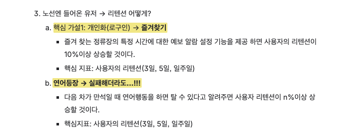
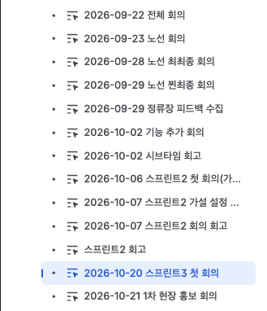
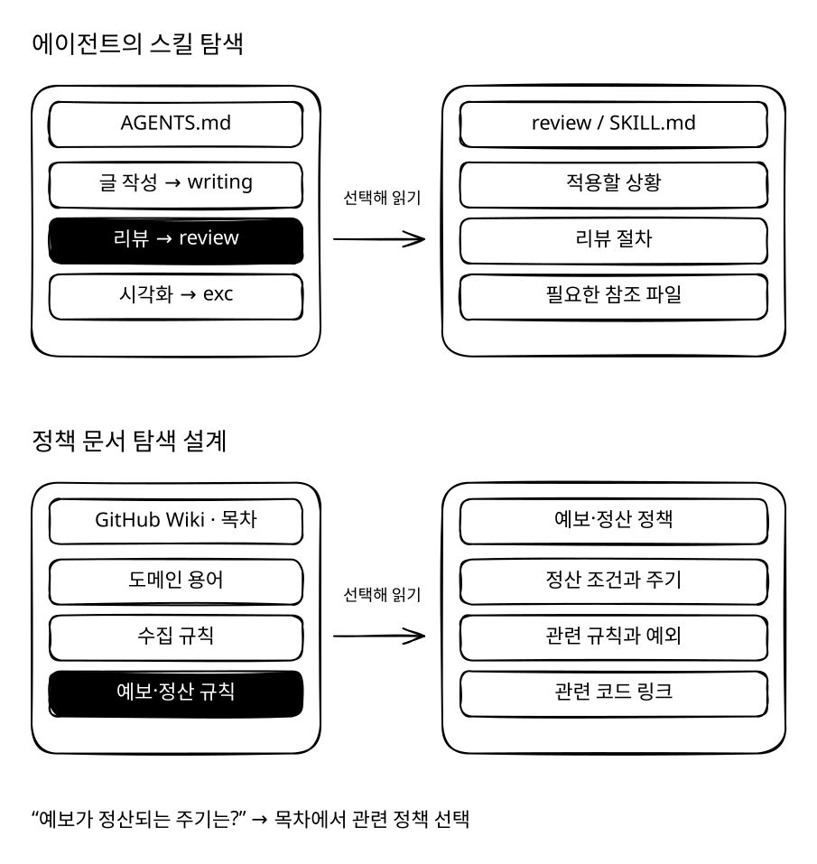
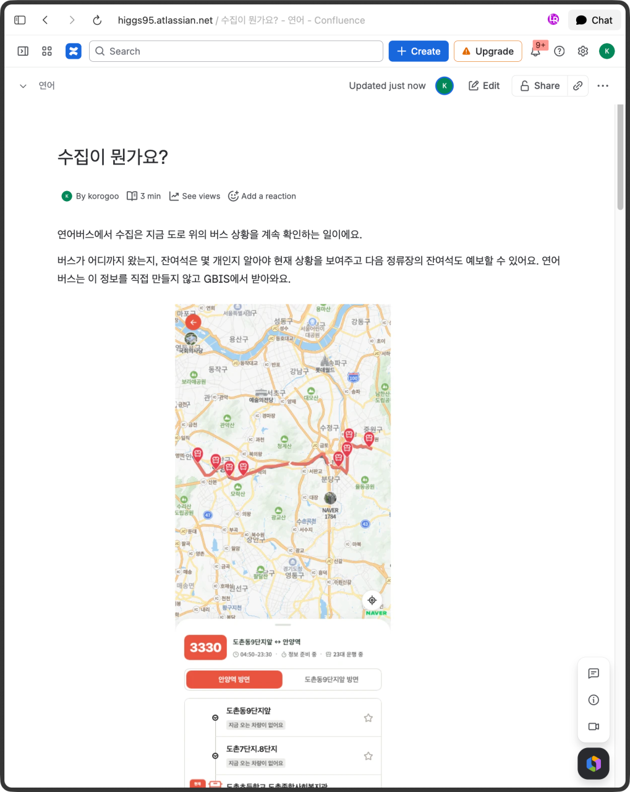
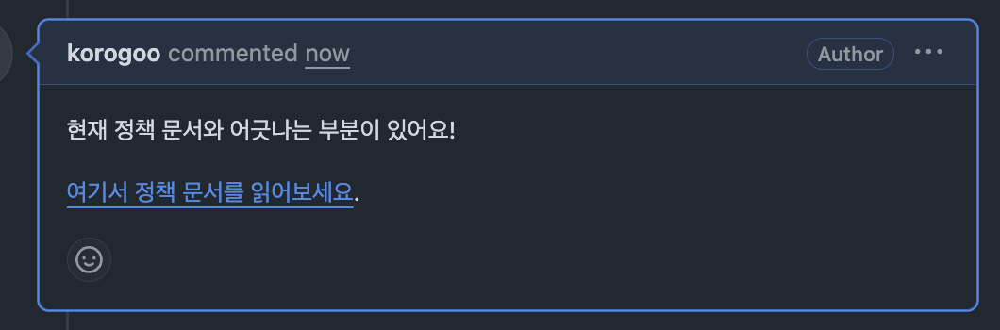
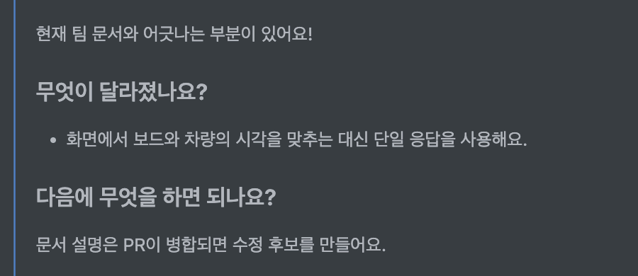
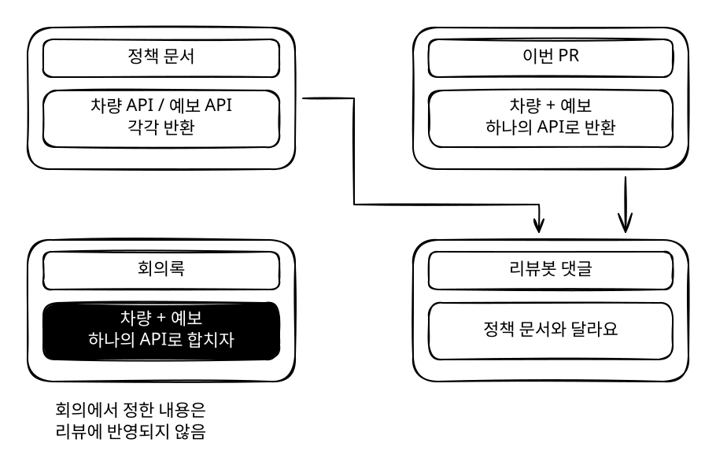
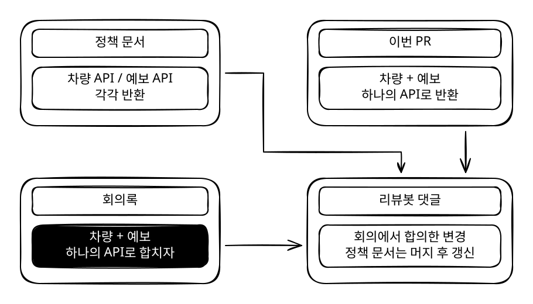
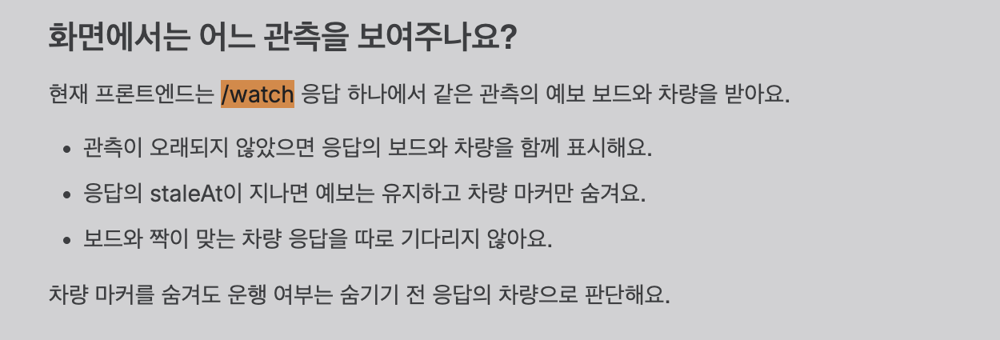
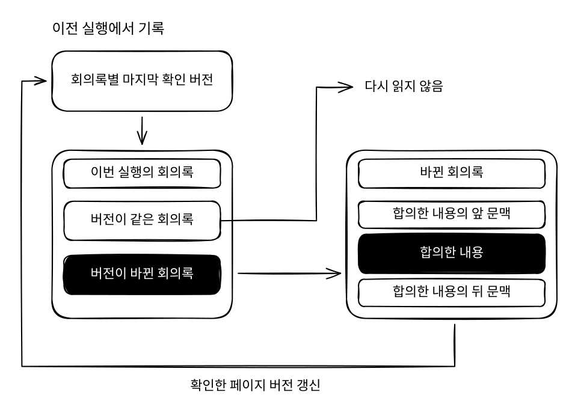

## '아 우리가 저번에 이렇게 하기로 했나?'

우리 팀의 규칙은 아래와 같다.

1. 코드 변경 사항은 PR을 통해 반영한다.
2. PR은 최소 1명 이상 리뷰한다.

그런데 PR을 볼 때마다\
‘아 우리가 저번에 이렇게 하기로 했었나?’ 하는 의문이 든다거나,
팀 회의를 하다 보면\
‘아 지금 계산이 그런 규칙으로 되고 있었나요?’ 같은 질문이 나온다.

보통 그러면
‘저번 주 회의록 보면 우리가 이렇게 정했던 거 적어놨어요’ 한다거나,\
‘데이터를 수집할 때는 이렇게 되고, 그래서 계산할 때는 이렇게 되고 있어요’ 하고 다시 설명한다.

그때는 아~ 하고 이해한다.
그런데 다른 작업을 하다 보면 금방 또 까먹고 다시 질문을 하게 된다거나  아예 기억 조차 못하게 된다.

## 그럼 매번 정책을 공부했어야 했나?

처음에는 **도메인 정책을 몰라서** 이런 상황이 반복된다고 생각했다.

모르면 부분을 싹 다 공부하면 되겠다고 생각했다.
근데 그러면 회의가 끝날 때마다 회의록을 다시 읽고,
다른 사람이 바꾼 코드까지 계속 공부해야 할까?

솔직히 현실적으로 그럴 여유가 없다.

당장 내일까지 로그인을 추가해야 하고, 이틀 뒤에는 즐겨찾기 기능도 추가해야 한다.
그 사이에 다른 사람의 작업 내용을 읽고 정책이 바뀌었는지까지 계속 확인할 시간이 있을까?

심지어 오늘 공부했던 수집 규칙이 내일 수정된 코드에서는 또 달라진다.
새로운 기능이 빠르게 추가되는 초기 팀에서는 규칙이 변하는 속도를 따라잡기 어렵다.\

심지어 사람의 기억력은 믿을 수도 없다!

## 그럼 필요할 때만 AI로 찾아보자!

팀 회의에서 정한 내용은 전부 Confluence 회의록에 남기고, 팀 내에서 합의된 내용은 형광펜을 치고 있다.

처음에는 도메인 규칙도 별로 없고, 설계에 시간을 투자하느라 기능 추가가 잦지 않았다.
그래서 형광펜 친 내용만 쭉 읽으면 도메인 정책을 충분히 파악할 수 있었다.

그런데 작업에 속도가 붙으면서 회의록이 일주일에 6~7개씩 생기기 시작했다.

...솔직히 하나씩 들어가서 읽기가 귀찮아졌고, 회의했던 내용을 놓치는 일도 빈번했다.

### 그럼 필요할 때만 찾아보면 되지 않을까?

궁금한 게 생기면 이렇게 질문한다.

“노선 추가 어떤 거 하기로 했더라? 컨플루언스에서 회의록 찾고 알려줘”\
“코드 읽고 예보가 정산되는 주기 알려줘”

다른 워크트리에서 작업 하나 하고 오면 금방 답을 알 수 있다.
근데 내가 모르는 사이에 PR이 2~3개 머지되고, 기존에 물어봤던 정책이 바뀌었다면?

이미 잘 알고 있다고 생각했던 정책을 굳이 다시 물어볼 일은 없을 것이고,
매번 같은 질문을 하면서 물어보는 것도 귀찮고 토큰도 아깝다.

## 정책 문서를 만들자

도메인 규칙을 문서화해두면 AI가 빠르게 규칙을 찾을 수 있지 않을까?
마치 에이전트가 skills를 찾아갈 때의 과정을 모방해서 필요한 부분만 찾아 읽도록 설계하고 싶었다.

예를 들어서 ‘예보가 정산되는 주기’를 알아낼 때 관련 코드를 찾아서 해석해오는 것이 아니라, 아래처럼 정책 문서를 만드는 것이다.

‘수집’이 뭔지, ‘관측’이 뭔지 설명하는 도메인 문서부터 시작해서
수집한 데이터를 어떤 트랜잭션 경계로 어디에 저장하며, 어떤 주기로 수집하는지 상세히 적고
필요하면 코드를 찾아볼 수 있도록 코드 링크를 건다.

### 잠만,,,도메인 문서를 과연 읽을까?

열심히 작성한 도메인 규칙... 이 문서를 과연 주기적으로 찾아서 읽을까?

처음 한두 번은 '오~ 이런 걸 만들었어?' 하고 읽어보겠지만,
바쁘게 작업하다 보면 회의록을 찾아 읽던 때랑 똑같은 문제가 발생할 것이다.
심지어 이젠 AI한테 물어보지 직접 문서를 읽을 일도 없다.

그렇다면 사람이 문서를 읽을 시점을 정하는 게 아니라,
필요한 순간에 도메인 문서를 딱 쥐어주면 좋을 것 같다는 생각이 든다.

그럼 '필요한 순간'은 언제고, 문서를 어떻게 전달할지 정해야 한다.

### 필요한 순간은 언제일까?

궁금한 게 생겼을 때,
그리고 작업하기 전에 내가 알고 있는 정책이 맞는지, 놓친 내용은 없는지 확인할 때다.

근데 이때마다 회의록과 정책 문서를 읽으라고 시키면 결국 같은 작업을 반복하게 된다.
내가 놓친 게 있다는 생각조차 못 하면 확인하지 않고 넘어갈 수도 있다.

그래서 작업한 사람과 리뷰하는 사람이 변경 내용을 같이 확인하는 PR 시점에 알려주면 좋겠다고 생각했다.

작업 전에 확인하는 것보다는 늦지만,
코드가 머지되기 전에 놓친 정책을 확인할 수 있고, 리뷰할 때도 같은 내용을 보고 이야기할 수 있다.

### 그럼 어떻게 전달할까?

우리 팀은 PR을 최소 한 명 이상 리뷰하는 것이 규칙이다.
그럼 어차피 확인하는 PR에 댓글로 알려주면 어떨까?

PR이 올라오면 AI가 변경된 코드와 관련된 회의록, 정책 문서를 찾아 읽고,
이번 변경과 관련해서 어떤 내용을 합의했는지 알려주는 것이다.

근데 PR에 도메인 문서 링크만 달아주면 나는 절대 안 읽고 싶을 것 같다..ㅎ
결국 링크에 들어가서 문서의 어느 내용이 이번 PR과 다른지 직접 찾아야 한다.

아래처럼 알려주면 어떨까?

“이 부분은 저번 회의에서 이렇게 하기로 했어요.”\
“이번 코드에서는 그 규칙이 이렇게 바뀌었어요.”

*실험 저장소에서 자동화가 남긴 댓글*

이런 식으로 도메인 문서를 찾아서 필요한 부분에 밑줄까지 그어 보여주면 편할 것 같다는 생각이다.

이렇게 알려주면 매번 문서를 읽으라고 시키지 않아도 되고,
리뷰하는 사람도 이미 합의한 내용을 알고 리뷰할 수 있을 것이다.

### 이게 최신 정책이라는 건 어떻게 알지?

기존에는 차량 데이터와 예보 데이터를 각각 다른 API로 반환하고 있었는데, 팀 회의 이후 하나의 API로 합쳐서 반환하기로 했다.

팀 레포와는 별도로 만든 실험 저장소에 기존 PR을 똑같이 올려봤다.
근데 차량이랑 예보를 합쳐서 반환하도록 바꾼 코드를 보고 **현재 팀 문서와 어긋난다고 지적했다.**

이미 회의에서 이렇게 하기로 했는데..!
문서에 없다는 이유로 다시 지적하는 일이 생긴 것이다.

그럼 회의가 끝날 때마다 정책 문서를 바로 고치면 될까?

문서를 먼저 고쳤는데 PR이 머지되지 않으면 다시 되돌려야 하고,
문서를 읽는 팀원도 지금 코드가 그렇게 동작하고 있다고 생각할 수 있다.

그래서 회의에서 정한 내용은 회의록에 그대로 두고,
PR을 리뷰할 때 정책 문서랑 회의록에서 합의한 내용을 같이 읽도록 했다.

그리고 PR이 머지되면 그때 정책 문서를 업데이트하도록 자동화했다.

### 그리고 회의록을 매번 읽는 것도 불편한데..

매번 처음부터 읽지 않도록 마지막으로 확인한 페이지 버전을 기록했다.
그 뒤에는 바뀐 회의록의 합의한 내용과 앞뒤 내용만 다시 읽도록 했다.

## 효과는 얼마나 있을까?

실험 저장소에서 동작하는 것까지는 확인했는데,
실제로 팀에서 썼을 때 효과가 얼마나 있을지는 더 봐야 한다.

사실 아직 리뷰봇에 여러 가지 도입해보고 싶은 것들이 있었다.

예를 들면 코드를 읽는 것, 해석하는 것, 리뷰의 점수를 매기는 것 등에 할당되는 모델의 티어를 조절한다거나,
유효한 리뷰를 선별하기 위한 점수 채점 작업,
리뷰를 더 재미있게 달기 위한 말투 스킬 등을 도입해보고 싶다.

근데 이걸 붙들고 하루, 이틀 더 끙끙대면서 하기보다는
팀원들에게 빠르게 공유해서 리뷰를 받아봐야겠다고 생각했다!

그리고 전후 비교를 위한 측정은 아래처럼 해보려고 한다.

### 같은 PR로 비교해보자

서로 다른 PR을 비교하면 변경한 코드도 다르고, 확인해야 할 정책도 다르다.
그래서 우선 같은 PR을 두 방식으로 리뷰해보려고 한다.

1. 필요할 때마다 회의록과 코드를 찾아 읽는 방식
2. 인덱스에서 필요한 정책을 찾고, 회의록에서 합의한 내용도 읽는 방식

이때 코드는 해당 PR의 리뷰 시점으로 고정하고, 회의록도 그때까지 작성된 내용만 사용한다.
나중에 갱신된 정책 문서를 읽히면 이미 답을 알려주고 비교하는 셈이 되니까.

모델이랑 리뷰 지침도 같게 두고, 문서를 찾고 읽는 방식만 바꿔서 비교해볼 생각이다.
모델 티어나 말투까지 한 번에 바꾸면 뭐 때문에 결과가 달라졌는지 알기 어려울 것 같다.

### 토큰만 줄면 되는 걸까?

토큰을 적게 썼어도 필요한 정책을 놓쳤다면 좋은 결과는 아니다.
그래서 비용이랑 리뷰 내용을 같이 확인하려고 한다.

- 이미 합의한 내용을 잘못 지적했는지 -> 회의록과 코드를 확인해서 해당 댓글 수 기록
- 실제 정책 위반을 찾았는지 -> 사람이 먼저 정리한 확인 항목 중 봇이 찾은 항목 수 기록
- 정책을 잘못 설명했는지 -> 댓글에 적힌 정책과 근거 문서를 대조
- 읽는 비용이 줄었는지 -> PR별 전체 실행의 입력, 출력, 캐시 토큰과 실제 비용 기록
- 얼마나 기다려야 하는지 -> 실행 시작부터 댓글 작성까지 걸린 시간 기록

댓글이 아예 없으면 잘못 지적하는 일도 없을 것이다.
그래서 불필요한 지적이 줄었는지만 보지 않고, 찾아야 할 문제를 놓치지는 않았는지도 확인해야 한다.

같은 PR도 실행할 때마다 결과가 달라질 수 있으니 여러 번 돌려보고,
평균만 적기보다는 PR별 결과와 차이도 남겨두려고 한다.

### 팀원들한테도 물어보자

실험에서 괜찮게 나와도 실제로 쓰기 불편하면 의미가 없다.

PR마다 댓글이 정책을 확인하는 데 도움이 됐는지,
회의록을 다시 찾거나 AI한테 별도로 물어볼 일이 있었는지,
잘못된 댓글을 읽고 설명하느라 오히려 시간을 쓰지는 않았는지 물어보려고 한다.

PR이 머지되기까지 걸린 시간도 기록할 수는 있겠지만,
팀원 일정이나 PR 크기에도 영향을 많이 받으니 그 숫자만 보고 효과가 있다고 판단하지는 않으려고 한다.

우선은 지금 만든 걸 공유하고,
팀원들이 실제로 어디서 도움을 받고 어디서 불편해하는지부터 확인해봐야겠다.
