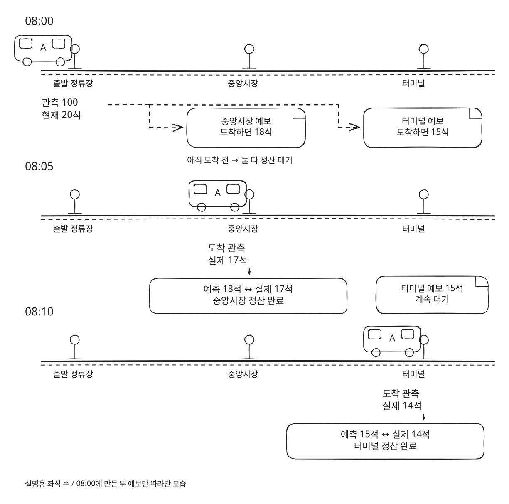
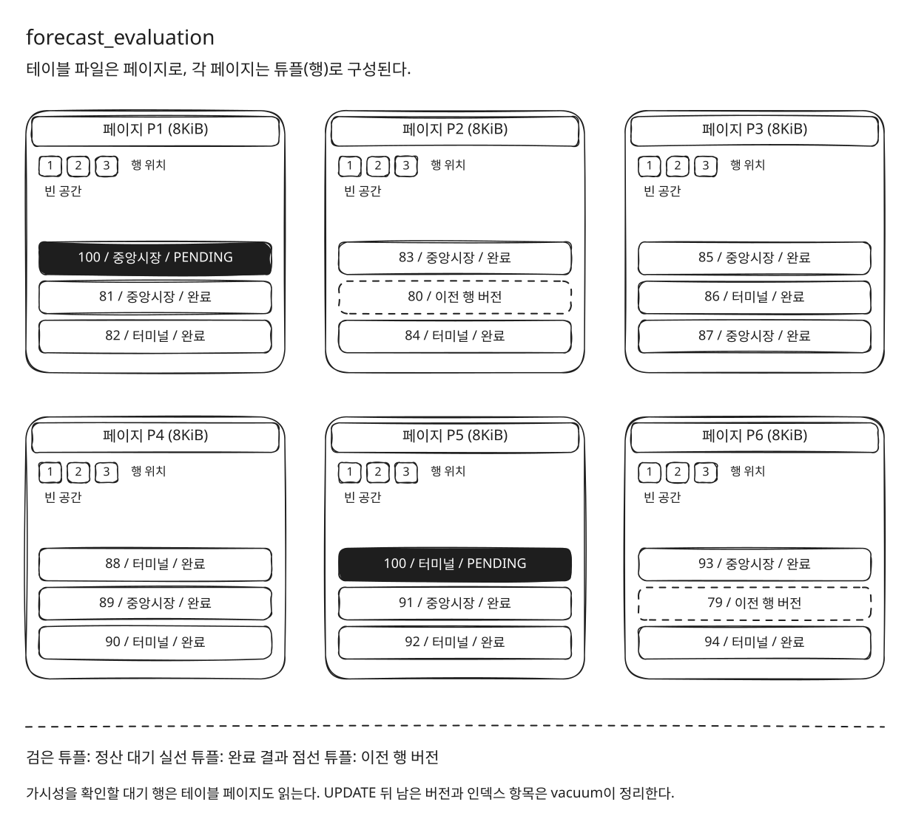
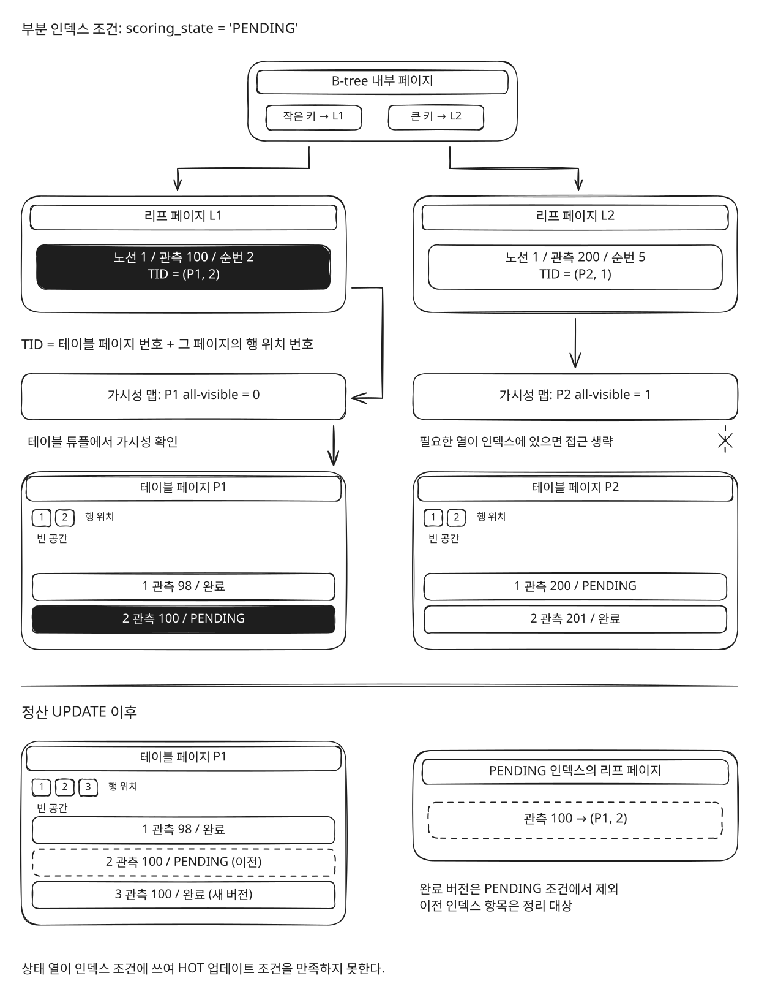
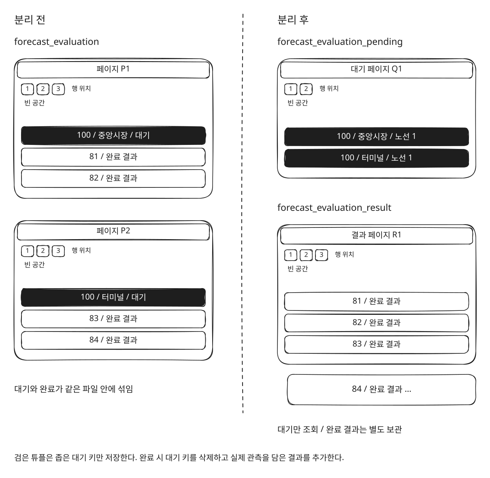
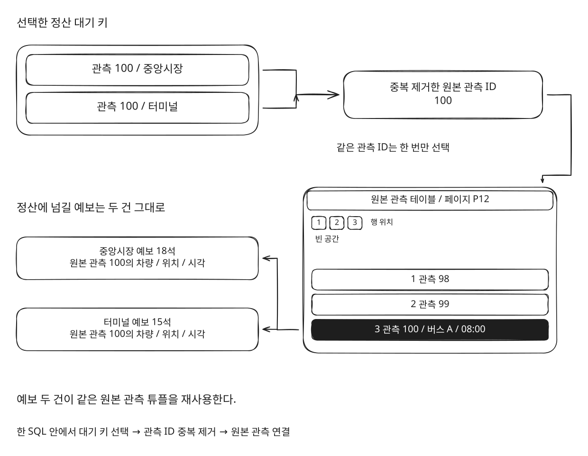
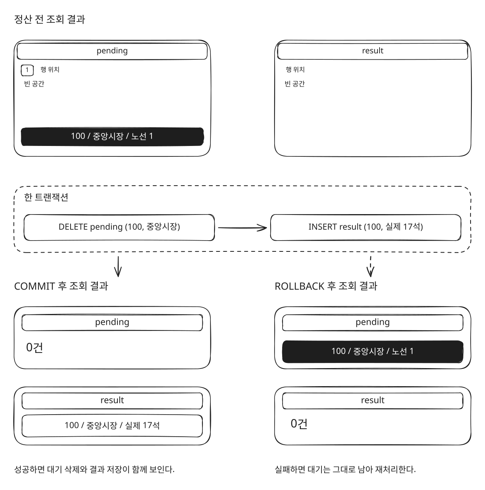
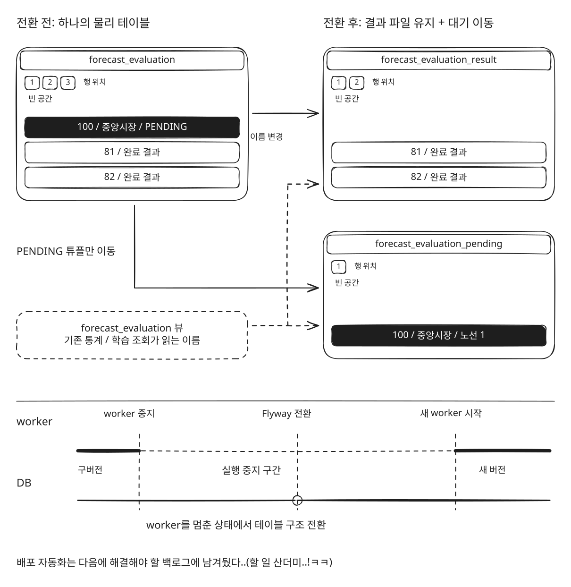
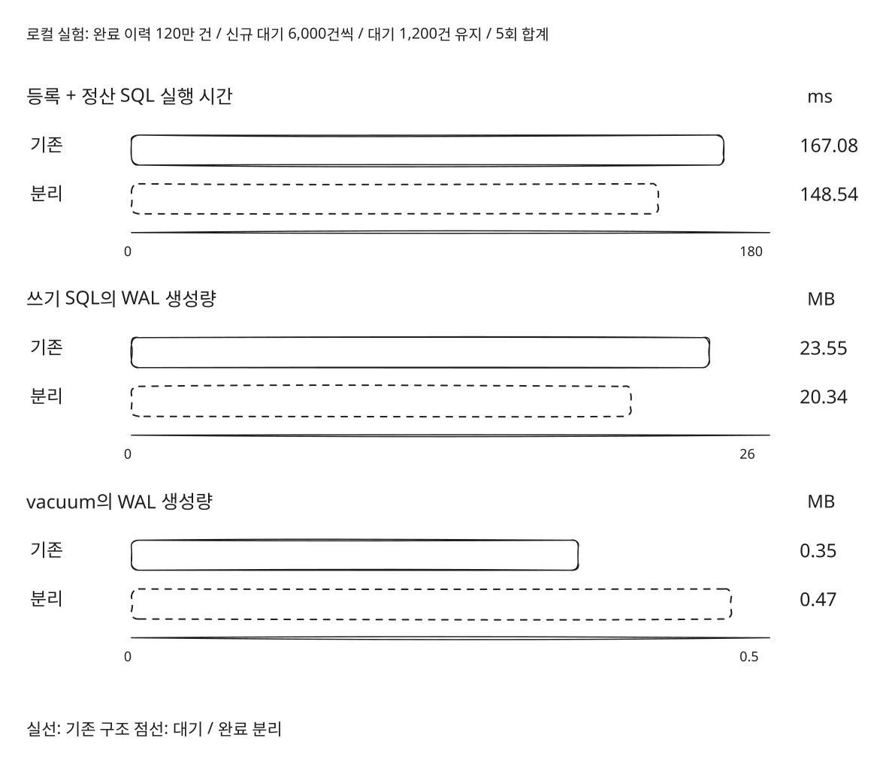

## 0. 정산이 뭔지부터 설명

연어버스는 버스가 내가 탈 정류장에 도착했을 때, 자리가 얼마나 남아 있을지 알려주는 서비스다.

지금 버스에 빈자리가 있어도 내가 타기 전까지 사람들이 더 탈 수 있다. 그래서 현재 잔여석과 앞으로의 잔여석을 구분해서 보여준다.

예보를 만들었다면, 실제로 얼마나 맞았는지도 확인해야 한다.

설명용으로 이런 상황을 생각해보자.

버스가 중앙시장에 도착하면 **18석이 남을 것이라고 예측**했다.

이후 버스가 중앙시장에 도착했고, 실제로는 **17석이 남았다는 관측**이 들어왔다.

이제 예측값과 실제 값을 비교할 수 있다.

이렇게 예보를 실제 도착 관측과 비교하고 결과를 저장하는 작업을 우리 서비스에서는 **정산**이라고 부른다.

예보를 만드는 시점에는 버스가 아직 목표 정류장에 도착하지 않았다. 바로 정산할 수 없으니 우선 대기로 등록하고, 나중에 들어오는 관측을 확인해야 한다.

```text
차량의 위치와 잔여석 수집
→ 앞으로 도착할 정류장들의 잔여석 예측
→ 정산 대기 등록
→ 이후 관측에서 목표 정류장 도착 확인
→ 예측값과 실제 잔여석 비교
→ 정산 결과 저장
```

여기서 한 번의 관측으로 여러 정류장의 예보를 만든다.

중앙시장과 터미널의 잔여석을 예측했다면 정산 대기도 각각 생긴다. 중앙시장에 도착했다고 터미널 예보까지 정산할 수는 없다. 중앙시장 예보는 완료되고, 터미널 예보는 계속 대기로 남는다.



이 작업을 반복하면서 정산할 기록은 계속 들어오고, 정산이 끝난 기록도 DB에 쌓이고 있었다.

## 1. 정산할 기록만 찾는데, DB는 왜 이렇게 많이 읽을까?

운영 중 RDS의 EBS 처리량 크레딧이 반복해서 바닥나는 상황이 있었다.

DB 재시작도 반복됐고, 사용자 화면에는 ‘데이터를 불러오지 못했습니다’가 나타났다. 사용자에게 데이터를 보여주지 못하는 상황부터 해결해야 했다.

읽기 부하가 어디서 발생하는지 확인해봤다.

그중 눈에 들어온 것이 **정산 대기 목록과 상세 정보를 가져오는 조회**였다. 정산을 기다리는 예보를 찾고, 실제 도착 여부를 판단할 관측을 연결하는 과정에서 많은 페이지를 읽고 있었다.

DB가 데이터를 읽는 단위인 페이지를 많이 확인할수록, 메모리와 디스크에서 처리할 작업도 늘어난다.

정산 조회만 실행되는 것도 아니었다.

당시 모니터링 기록에는 예보 평가 테이블의 자동 정리 작업인 `vacuum`이 약 23~24분마다 실행되고, 한 번에 약 6GiB의 버퍼 읽기를 발생시키는 모습도 남아 있었다. 버퍼 읽기량과 저장 장치에서 실제로 읽은 양은 서로 다른 지표다.

정산 작업은 아직 처리하지 않은 기록만 찾으면 된다.

그런데 같은 테이블에는 이미 정산을 끝낸 기록도 계속 쌓이고 있었다.



**대기 중인 기록을 찾는 작업과, 계속 쌓이는 테이블을 정리하는 작업이 같은 구조 안에서 반복되고 있었다.**

왜 이런 비용이 발생하는지 조회 조건과 상태 변경 방식을 같이 확인해보기로 했다.

## 2. 인덱스도 있는데, 왜 테이블까지 읽고 있지?

정산 대기 조회에는 인덱스가 있었다.

모든 기록을 조회할 필요는 없으니, `PENDING` 상태인 기록만 포함하는 **부분 인덱스**를 사용하고 있었다. 조회에 필요한 열을 인덱스에 담아 테이블 접근을 줄이려는 구성도 있었다.

그럼 인덱스에서 필요한 값만 가져오면 되는 것 아닐까?

PostgreSQL에서는 필요한 열이 인덱스에 모두 있어도, **그 행을 현재 조회에서 읽어도 되는지** 확인해야 한다.

여러 트랜잭션이 동시에 데이터를 읽고 바꾸기 때문이다.

PostgreSQL은 테이블 페이지마다 모든 행을 읽어도 되는지 표시한 정보를 관리한다. 이 표시를 확인할 수 있으면 테이블 접근을 생략하지만, 최근 변경으로 표시가 해제된 페이지는 테이블을 직접 확인해야 한다. [PostgreSQL 공식 문서](https://www.postgresql.org/docs/18/indexes-index-only-scans.html)

우리 데이터는 계속 바뀌고 있었다.

예보가 생기면 대기 행을 넣고, 정산이 끝나면 같은 행의 상태와 도착 관측 정보를 갱신했다.

```text
예보 생성
→ PENDING 행 INSERT

정산 완료
→ 같은 행의 상태와 완료 근거 UPDATE
```

상태를 바꾸는 작업은 인덱스에도 영향을 줬다.

`PENDING`인 행만 인덱스에 들어가므로, 완료 상태로 바뀐 행은 더 이상 그 조건에 맞지 않는다.

PostgreSQL에는 인덱스 갱신을 생략할 수 있는 **HOT 업데이트**라는 최적화가 있다. 하지만 인덱스가 참조하는 열을 바꾸지 않아야 하는 등의 조건이 필요하다. 우리처럼 부분 인덱스의 조건에 쓰는 상태 열을 바꾸는 작업은 이 조건을 만족하지 못한다. [PostgreSQL 공식 문서](https://www.postgresql.org/docs/18/storage-hot.html)

UPDATE 이후에는 더 이상 필요하지 않은 이전 행 버전과 인덱스 항목도 정리해야 한다. 이 작업을 vacuum이 맡는다.



결국 인덱스가 있다는 사실만으로 충분하지 않았다.

**무엇을 조회하는지뿐 아니라, 같은 데이터가 얼마나 자주 바뀌고 어떻게 정리되는지도 봐야 했다.**

## 3. 이미 정산이 끝난 기록을 같은 테이블에 둬야 할까?

기존에는 정산 대기와 완료 결과를 `forecast_evaluation`이라는 테이블 하나에 저장했다.

처음에는 자연스러운 구조였다.

예보가 만들어지면 대기 상태로 넣고, 정산이 끝나면 상태를 바꾸면서 결과를 채우면 된다.

근데 두 데이터가 쓰이는 방식은 달랐다.

**대기 기록**은 정산 작업이 반복해서 조회한다.

실제 도착 관측을 찾으면 처리하고, 더 이상 대기로 남겨둘 필요가 없다.

**완료 기록**은 예보가 얼마나 맞았는지 통계를 내거나, 이후 학습에 활용하기 위해 보관한다.

정산 대기 목록을 찾을 때마다 확인할 데이터는 아니다.

그렇다면 같은 테이블에서 상태로 구분하는 대신, 저장 위치부터 나누면 어떨까?

대기 기록은 `forecast_evaluation_pending`에, 완료 결과는 `forecast_evaluation_result`에 저장하도록 나눴다.

대기 테이블에는 정산 대상을 식별하는 값만 남겼다.

- 예보를 만든 원본 관측 ID
- 예보 대상 정류장 순번
- 노선 버전 ID

정산이 끝나면 대기 행을 삭제하고, 실제 도착 관측과 정산 결과를 완료 테이블에 넣는다.



이렇게 하면 자주 바뀌는 대기 데이터와 계속 보관할 완료 데이터를 나눠서 관리할 수 있다.

완료 이력이 늘어도 정산 대기 테이블의 행 수가 함께 늘지는 않는다. 대기 테이블에서 발생하는 삭제와 정리 작업도 완료 이력과 분리할 수 있다.

물론 완료 테이블의 저장 공간과 정리 비용까지 없어지는 것은 아니다. DELETE도 이전 행 버전을 남기고, INSERT도 새로운 쓰기를 발생시킨다.

**구조를 나눴다는 이유만으로 더 저렴해졌다고 할 수는 없다.**

우선 반복해서 처리할 데이터와 보관할 데이터를 분리했다. 다음으로는 중복해서 읽던 관측 정보를 줄이고, 바뀐 저장 방식의 비용도 비교해보기로 했다.

## 4. 같은 관측으로 만든 예보인데, 관측 정보도 매번 다시 읽어야 할까?

저장 구조와 별개로, 대기 목록을 읽는 과정에도 중복이 있었다.

정산하려면 대기 중인 예보뿐 아니라, 그 예보를 만들었던 원본 관측 정보도 필요하다. 어떤 차량이 언제 어디에 있었는지 알아야 이후 관측과 연결할 수 있기 때문이다.

근데 하나의 관측에서 여러 정류장의 예보를 만든다고 했다.

앞에서 든 예시처럼 관측 100번으로 중앙시장과 터미널의 잔여석을 예측했다면, 두 예보가 참조하는 원본 관측은 같다.

예보는 두 건이지만 원본 관측 정보까지 각각 가져올 필요가 있을까?

기존 조회는 먼저 대기 키 목록을 고른 뒤, 상세 정보를 연결하는 과정에서 같은 대기 범위를 다시 조회하고 있었다.

이 과정을 하나의 SQL 안에서 처리하도록 바꿨다.

```text
① 정산할 대기 키를 한 번 선택
② 원본 관측 ID의 중복 제거
③ 원본 관측 정보 조회
④ 각 예보에 연결
```

여기서 줄이는 것은 예보 건수가 아니다.

중앙시장 예보와 터미널 예보는 각각 정산해야 하므로 둘 다 남긴다. 대신 **대기 범위를 다시 조회하는 작업과, 같은 원본 관측 정보를 반복해서 가져오는 작업을 줄였다.**



## 5. UPDATE 한 번을 DELETE와 INSERT로 바꾸면 더 비싸지 않을까?

조회 중복을 줄이는 것과 저장 방식을 바꾸는 것은 별개의 문제다.

기존에는 정산이 끝나면 한 행을 UPDATE했다. 바꾼 구조에서는 대기 행을 DELETE하고, 완료 결과를 INSERT한다.

명령만 보면 오히려 할 일이 늘어난 것 같다.

DELETE도 정리할 이전 행 버전을 남긴다. 완료 결과를 넣을 때는 테이블과 인덱스에 새로 쓰고, 장애 복구에 사용하는 변경 기록인 WAL도 생성한다.

**대기 테이블이 작아진다는 이득만 보고, 쓰기 비용까지 줄었다고 판단할 수는 없었다.**

비용을 비교하기 전에, 두 작업이 같이 성공하도록 만드는 것도 필요했다.

대기 행만 지워지고 완료 결과를 저장하지 못하면 어떻게 될까?

아직 결과가 없는데 정산 대상에서도 사라진다. 다음 실행에서는 그 예보를 다시 처리할 수 없다.

그래서 대기 삭제와 결과 저장을 같은 SQL과 트랜잭션에서 처리했다.

```text
대기 행 삭제 + 완료 결과 저장
→ 둘 다 성공하면 커밋
→ 결과 저장에 실패하면 대기 삭제도 취소
```

이렇게 처리하면 저장에 실패한 기록은 대기로 남아 다시 정산할 수 있다.



정산 결과를 보존하는 조건을 먼저 맞추고, 그다음 기존 UPDATE 방식과 비용을 비교했다.

## 6. 테이블을 나누면 기존 통계와 배포는 어떻게 하지?

테이블을 나눴다고 정산 코드만 바꾸면 끝나는 것은 아니었다.

기존 통계와 학습 조회도 `forecast_evaluation`을 읽고 있었다. 이 이름을 갑자기 없애면 기존 조회를 모두 바꿔야 한다.

그래서 기존 이름은 **두 테이블을 합쳐 읽는 뷰**로 남겼다.

기존 조회가 보던 열과 데이터의 의미를 유지하고, 새로운 정산 코드는 실제 대기 테이블과 결과 테이블에 쓰도록 했다.

기존 데이터를 옮기는 비용도 생각해야 했다.

완료 이력을 전부 새 테이블로 복사하는 대신, 기존 테이블의 이름을 결과 테이블로 바꾸고 대기 행만 새 대기 테이블로 이동하도록 했다.

문제는 이 구조로 전환하는 동안에도 구버전 worker가 실행될 수 있다는 점이었다.

기존 배포 순서는 API가 먼저 시작하면서 DB 마이그레이션을 실행하고, 이후 worker를 교체하는 방식이었다. 그사이에 구버전 worker가 실행되면, 테이블이었던 `forecast_evaluation`이 이미 뷰로 바뀐 상태에서 기존 쓰기 작업을 시도할 수 있다.

그러면 새 API가 정상적으로 시작됐더라도 worker에서는 오류가 발생할 수 있다.

이번에는 머지 직전에 worker를 직접 멈추고, 완전히 종료됐는지 확인한 뒤 마이그레이션과 새 worker 시작을 확인하는 절차를 잡았다.

실패했을 때도 구버전 실행 파일만 다시 올리면 되는 구조가 아니었다. DB는 이미 바뀌었을 수 있으므로, worker가 어떤 스키마에 쓰는지까지 확인해야 했다.



이 전환 과정까지 자동으로 처리하는 건 다음에 해결해야 할 백로그에 남겨뒀다..(할 일 산더미..!ㅋㅋ)

## 7. 그래서 비용은 얼마나 달라졌을까?

쓰기 비용은 같은 조건의 로컬 실험으로 비교했다.

완료 이력 120만 건을 준비하고, 회차마다 신규 대기 6,000건을 등록했다. 대기 1,200건을 유지하면서 정상 정산을 5회 반복한 합계다.

| 측정 항목                        | 기존 구조 | 분리한 구조 |
| -------------------------------- | --------: | ----------: |
| 등록과 정산의 쓰기 SQL 실행 시간 |  167.08ms |    148.54ms |
| 쓰기 SQL의 WAL 생성량            |   23.55MB |     20.34MB |
| vacuum의 WAL 생성량              |    0.35MB |      0.47MB |

이 조건에서는 쓰기 SQL 실행 시간이 약 11%, 쓰기 SQL의 WAL 생성량이 약 14% 줄었다.

DELETE와 INSERT로 나눴다고 쓰기 비용이 반드시 더 커지는 것은 아니었다.

그렇다고 모든 비용이 줄어든 것도 아니다. vacuum이 생성한 WAL은 오히려 늘었다. 실행 시간과 WAL 생성량도 서로 다른 지표이므로 하나의 개선율로 합칠 수 없다.



대기와 완료 기록을 나누면서, 이 실험에서는 등록과 정산의 쓰기 시간과 쓰기 WAL도 줄일 수 있었다. 대신 vacuum의 WAL은 늘었다. 테이블 크기 하나만 보는 대신, 반복 조회와 쓰기, 정리 비용을 각각 비교하면서 구조를 선택해야 했다.
