## 0. 일단 용어 정의! 정산이 뭘까?

연어버스는 버스가 특정 정류장에 도착했을 때 자리가 얼마나 남아 있을지 알려주는 서비스다.

지금 빈자리가 있어도 도착하기 전에 다른 사람이 탈 수 있다.\
그래서 현재 남은 좌석 수와 정류장에 도착했을 때의 예상 좌석 수를 구분해서 보여준다.

그리고 예상 좌석수의 정확도를 높이기 위해서 실제로 예측값이 맞았는지도 채점해야 한다.

예를 들어

- 버스가 중앙시장에 도착하면 18석이 남을 것으로 예측했다.
- 이후 실제로 중앙시장에 도착했고, 17석이 남았다는 관측이 들어왔다.
- 이제 예측값과 실제 값을 비교해서 결과를 저장할 수 있다.

이 작업을 정산이라고 부른다.

근데 예보를 만드는 시점에는 아직 버스가 목표 정류장에 도착하지 않았다.\
바로 비교할 수 없으니 대기로 등록하고, 이후 관측에서 실제 도착을 확인해야 한다.

그리고 한 번의 관측으로 여러 정류장의 예보를 만든다.\
같은 버스의 관측으로 중앙시장과 터미널을 예측했다면 정산 대기도 2개가 된다.\
그리고 중앙시장에 도착하면 중앙시장 예보는 완료하고 터미널 예보는 그대로 대기로 남는다.

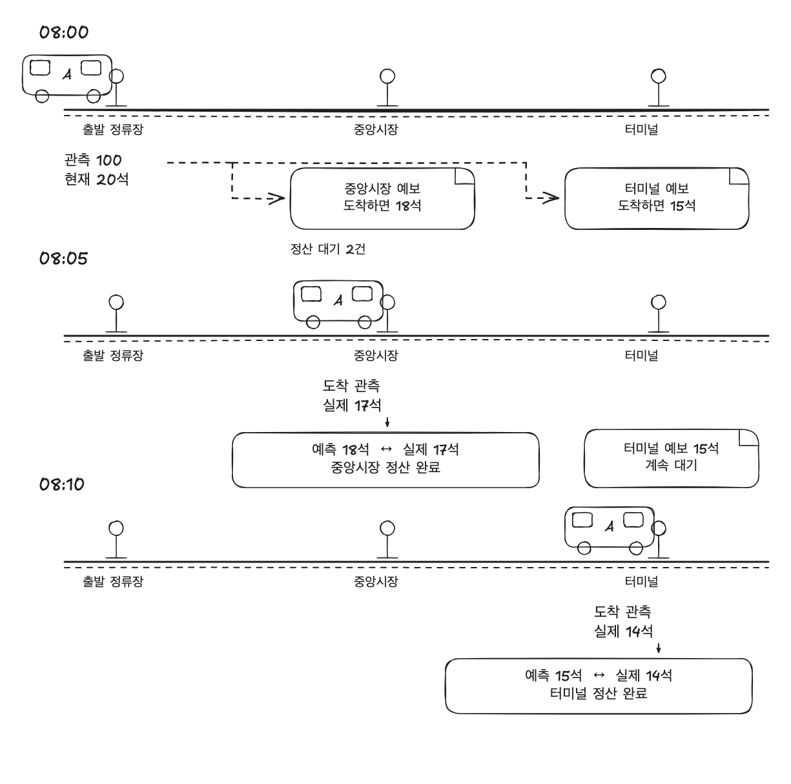

하나의 관측에서 만든 예보 두 건의 정산 시점. 정류장과 좌석 수는 설명용 예시다.

## 1. vacuum이 왜이렇게 자주 돌아..?

운영 모니터를 확인해보니까 forecast\_evaluation 테이블의 vacuum이 거의 23\~24분마다 실행되고 있었다.\
그리고 한 번 실행할 때 약 6GiB의 버퍼 읽기도 발생했다.

알아보니 정산 대기와 완료 결과는 `forecast_evaluation`이라는 테이블 하나에 저장했다.\
예보가 생기면 `PENDING` 상태로 INSERT했다가\
정산이 끝나면 같은 행의 상태와 도착 관측 정보를 UPDATE했다.

여기서 문제는 PostgreSQL는 UPDATE할 때 기존 행의 값을 그대로 덮어쓰지 않고, 새로운 버전의 행을 만든다.\
변경 전에 시작한 다른 트랜잭션의 조회에서는 이전 값이 필요할 수 있기 때문이다.

예를 들어 정산 상태를 바꾸면 다음과 같은 두 버전이 생긴다.

```txt
UPDATE 전
이전 버전: 관측 100, 목표 정류장 9, PENDING

UPDATE 후
이전 버전: 관측 100, 목표 정류장 9, PENDING
새 버전:   관측 100, 목표 정류장 9, SETTLED
```

그리고 이전 버전이 더 이상 어떤 트랜잭션에도 필요하지 않게 되면 정리 대상인 dead tuple이 된다.\
이 버전의 행의 값과 위치를 가리키는 인덱스 항목도 더 이상 필요하지 않게 되므로 dead index tuple이 된다.

vacuum은 dead tuple들을 정리하고 공간을 다시 사용할 수 있게 한다.\
그리고 역시 vacuum도 테이블과 인덱스의 페이지를 읽고, 정리한 내용을 반영하는 I/O 작업을 한다.\
정산 조회가 실행되는 동안 이런 정리 작업도 같은 DB 자원을 사용하고 있었다.

근데 이런 상태 변경은 정리 비용뿐 아니라 정산할 예보를 조회할 때도 영향을 준다.

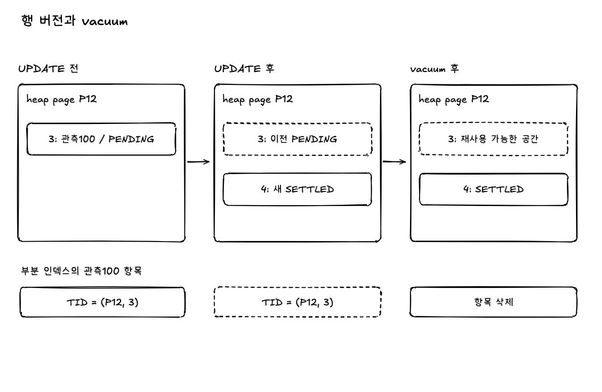

이전 행 버전과 인덱스 항목의 정리. 페이지 배치는 설명용이고, vacuum 주기와 버퍼 읽기는 운영 관측값이다.

## 2. 커버링 인덱스인데,, 왜 page를 읽어오는 거지?

### 조회할 때의 heap 접근

아직 정산이 되지 않은 예보 정보를 조회할 때는 `PENDING` 행만 포함하는 부분 인덱스가 있었고, 조회 성능을 높여 보려고 커버링 인덱스를 만들었다.\
이런 커버링 인덱스를 만들어 두면 PostgreSQL에서는 인덱스의 값만 가져오는 `Index Only Scan`이 가능해진다.

근데 인덱스에 값이 있다고 바로 반환할 수 있는 것은 아니었다.\
조회 시점에 읽을 수 있는 행 버전인지도 확인해야 하는데\
이 정보는 인덱스 항목에 없고, 실제 행이 저장된 heap page에 있다.

PostgreSQL은 페이지별로 모든 행이 모든 트랜잭션에서 보이는지를 visibility map으로 표시한다.

- `all-visible` → heap의 행을 다시 확인X → 바로 인덱스의 값을 반환
- 표시가 없음 → heap의 행을 방문 → 현재 조회에서 읽을 수 있는지 확인

근데 정산이 끝나서 행을 갱신하면 그 페이지의 all-visible 표시가 해제될 수 있다.\
그래서 필요한 열이 인덱스에 있어도 이런 페이지에서는 heap까지 가서 읽을 수 있는 행 버전인지를 확인해야 한다.\
(vacuum은 조건을 만족하는 페이지에 all-visible 표시를 다시 설정하는 역할도 있음)

그리고 heap page에 접근했다고 매번 디스크를 읽는 것도 아니다.\
필요한 페이지가 PostgreSQL 공유 버퍼에 있으면 메모리에서 찾는다.


**PostgreSQL에는 HOT 업데이트가 있는데요?**

사실 PostgreSQL에는 기존 인덱스 항목을 재사용하고, 같은 heap page 안에서 새 행 버전을 연결하는 HOT 업데이트가 있다.

그치만 HOT 업데이트가 가능한 조건이 있다.

- 인덱스가 참조하는 열의 값을 수정하지 않는다.
  - 인덱스의 검색키인 열
  - 인덱스의 조건절에 쓰이는 열
- 같은 페이지에 새 버전을 넣을 공간이 있어야 한다.

근데 정산 대기 조회의 부분 인덱스는 `scoring_state = 'PENDING'`을 조건으로 사용하고 있었고, 정산이 완료될 때 이 값을 SETTLED로 수정하고 있었다.\
그래서 정산이 끝나면 다음처럼 바뀐다.

```txt
이전 행 버전: scoring_state = PENDING
→ 대기 인덱스에 포함

새 행 버전: scoring_state = SETTLED
→ 대기 인덱스에 포함하지 않음
```

그래서 이 업데이트를 HOT 업데이트로 처리할 수 없었다.

그리고 HOT 업데이트가 가능해도 all-visible 표시가 유지된다는 뜻도 아니다.

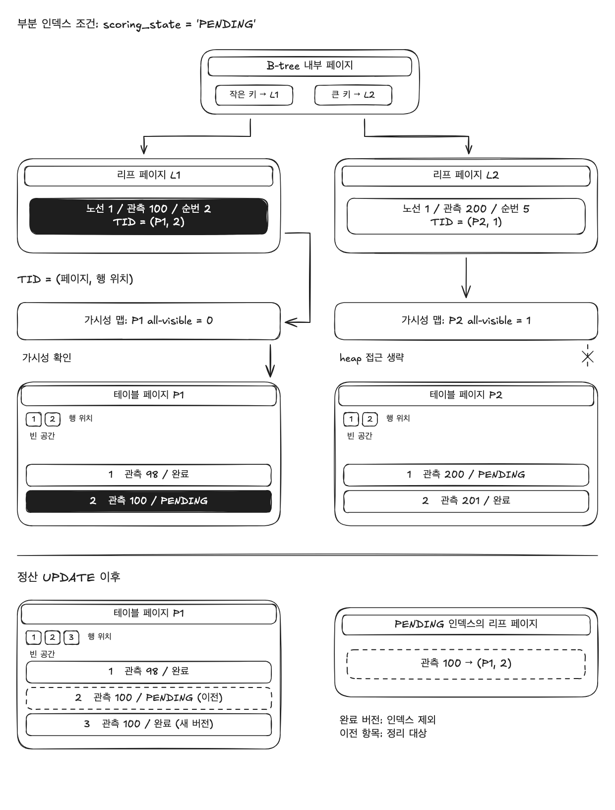

인덱스의 행 위치와 heap 가시성 확인, 부분 인덱스 조건 변경. 인덱스 열과 페이지 주소는 원리 설명용 예시다.

## 3. 정산해야 할 데이터, 완료된 데이터의 테이블을 분리해볼까?

이렇게 상태를 계속 갱신하면 정리할 행 버전이 생기고, all-visible 표시가 해제된 페이지는 인덱스로 찾아도 heap까지 가서 읽을 수 있는 버전인지 확인해야 하는 상황이다.

그러면 해당 테이블을 조회하는 다른 작업을 위해서라도 테이블을 분리해볼까?

예를 들면 정산이 된 데이터는 예보 정확도 보정이나 통계 모델 학습을 위해 조회되고 있는데

정산의 완료 상태를 관리하는 테이블이랑 정산까지 완료된 조회용 데이터를 분리해서 조회하는 것이다.

그래서 대기 목록은 `forecast_evaluation_pending`에,\
완료 결과는 `forecast_evaluation_result`에 저장하도록 나눴다.

| 테이블 | 저장하는 값 | 사용하는 작업 |
| --- | --- | --- |
| forecast\_evaluation\_pending | 관측 ID, 목표 정류장 순서, 노선 판본 ID | 정산할 예보 조회 |
| forecast\_evaluation\_result | 정산 상태, 실제 도착 관측, 좌석 수 등 결과와 정산 대상 키 | 정확도 통계와 학습 조회 |

예보가 생기면 이 키를 INSERT하고, 정산이 끝나면 대기 행을 DELETE하고 완료 결과를 INSERT한다.

```txt
기존
forecast_evaluation
  PENDING 행 INSERT
  -> 같은 행을 완료 상태와 도착 관측 정보로 UPDATE

변경
forecast_evaluation_pending
  대기 키 INSERT
  -> 정산 후 대기 행 DELETE

forecast_evaluation_result
  정산 결과 INSERT
```

이렇게 하면 대기 행을 넣고 지워도 완료 이력의 페이지는 바꾸지 않으니, 그 변경 때문에 가시성 표시가 해제되는 것도 피할 수 있다.

그리고 대기 행 삭제와 완료 결과 저장은 같은 트랜잭션에서 처리했다.\
대기만 삭제되고 결과가 저장되지 않으면, 다음 실행에서 다시 정산할 수도 없기 때문이다.


**DELETE도 dead tuple이 생기는데요?**

물론 대기를 삭제하는 방식으로 바꿔도 dead tuple은 생긴다.\
완료 결과를 INSERT하는 쓰기 비용도 있고, 완료 테이블도 vacuum이 필요하다.\
테이블을 분리했다고 정리 작업이 없어지거나 vacuum 횟수가 반드시 줄어드는 것은 아니다.

이 구조에서 정산 조회와 쓰기 비용이 어떻게 달라지는지 비교해보기로 했다.

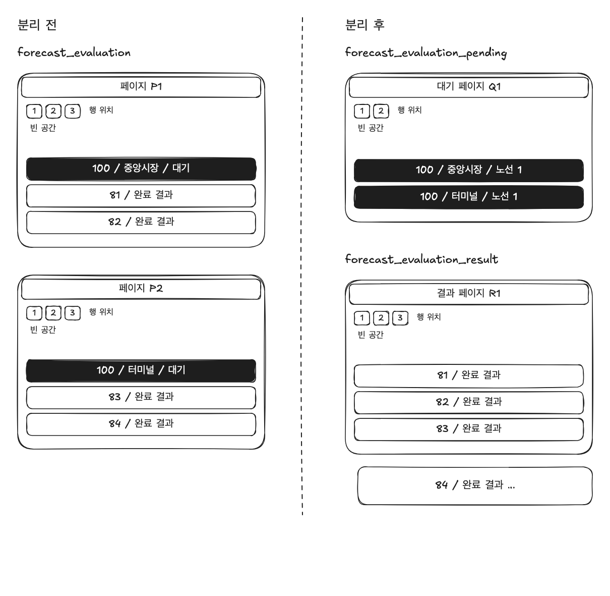

대기와 완료 결과의 페이지 분리. DELETE 뒤에도 정리할 행 버전이 남는다. 페이지 배치는 설명용이다.

## 4. 그래서 테이블을 나누고 뭐가 달라졌을까?

UPDATE 한 번이 DELETE와 INSERT로 바뀌었으니까 쓰기 비용은 더 커지는 게 아닐까?\
그래서 당시에는 등록과 정산의 쓰기 비용을 따로 비교했다.

로컬에 실험 데이터 120만 건을 두고, 회차마다 신규 대기 6,000건을 등록했다.\
대기 1,200건을 유지하면서 정상 정산을 5회 반복한 합계다.

| 측정 항목 | 기존 UPDATE 방식 | 대기와 완료 분리 후 |
| --- | --- | --- |
| 등록과 정산의 쓰기 SQL 실행 시간 | 167.08ms | 148.54ms |
| 쓰기 SQL의 WAL 생성량 | 23.55MB | 20.34MB |
| vacuum의 WAL 생성량 | 0.35MB | 0.47MB |

이 조건에서는 쓰기 SQL 실행 시간이 약 11%, 쓰기 WAL이 약 14% 줄었다.

근데 vacuum의 WAL은 오히려 늘었다. (WAL은 장애 복구를 위해 남기는 DB 변경 기록이다.)

## 5. 같은 관측인데, 예보마다 다시 조회해야 할까?

테이블을 나눈 다음에는 정산 대기 목록을 가져오는 SQL을 확인해봤다.\
근데 처리할 대상을 고를 때 읽었던 대기 목록을 상세 조회에서 다시 읽고 있었다.

```txt
기존
1. 대기 목록에서 이번에 정산할 대상 선택
2. 상세 조회에서 같은 대기 목록을 다시 조회
3. 관측, 수집 배치, 예보 연결
```

이미 고른 목록인데 다시 조회할 필요가 있을까?\
그래서 두 SQL을 하나로 합치고, 처음 고른 대기 목록을 상세 조회에서도 사용하도록 바꿨다.

관측 정보도 재사용할 수 있었다.\
한 관측으로 여러 정류장의 예보를 만들기 때문이다.

설명용으로 관측 100에서 정류장 3개에 대한 예보를 만들었다고 해보자.

| 정산할 예보 | 필요한 관측 |
| --- | --- |
| A 정류장 예보 | 관측 100 |
| B 정류장 예보 | 관측 100 |
| C 정류장 예보 | 관측 100 |

예보는 각각 정산해야 한다.\
그치만 관측 100의 차량과 관측 시각은 세 예보에서 모두 같다.

그래서 대기 목록에서 관측 ID의 중복을 먼저 제거했다.\
그다음 필요한 관측과 수집 배치 정보를 가져와서 각 예보에 연결했다.

```txt
변경 후
1. 이번에 정산할 대기 목록 선택
2. 목록에서 중복 없는 관측 ID 추출
3. 필요한 관측과 수집 배치 정보 조회
4. 각 예보에 연결
```

이때 `MATERIALIZED`로 중간 결과를 저장하도록 했다.\
같은 대기 목록과 관측 정보를 뒤에서 사용할 때 다시 조회하지 않으려는 의도였다.\
별도 테이블에 저장하는 것은 아니고, SQL이 실행되는 동안 사용할 결과를 보관하는 것이다.

변경 후 실행 계획에서는 수집 배치 인덱스를 찾는 횟수가 834번에서 250번으로 줄었다.

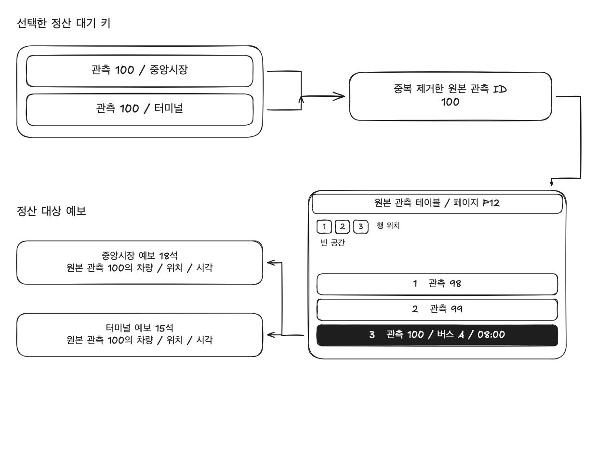

원본 관측 하나를 두 정류장 예보가 참조하는 구조. 관측100과 정류장은 설명용 예시다.

## 6. 버퍼 접근은 줄었다! 근데 실행 시간이 그대로..

로컬에서 실험을 돌렸다.

| 항목 | 기존 2개 SQL | 통합 SQL |
| --- | --- | --- |
| 전체 shared hit | 18,037회 | 12,770회 |
| DB 실행 시간 중앙값 | 5.830ms | 6.193ms |

`shared hit`은 필요한 페이지를 PostgreSQL 공유 버퍼에서 찾은 횟수다.\
(같은 페이지를 읽어도 횟수로 카운트된다.)

버퍼 접근은 약 29% 줄었는데 실행 시간은 조금 늘었다.\
만약 디스크 접근을 줄였다면 차이가 컸겠지만,\
원래도 디스크가 아니라 메모리에서 읽고 있어서 시간 차이는 작았던 것 같다.

여기에 중복된 관측 ID를 제거하고 중간 결과를 저장한 뒤 다시 읽는 작업이 추가되면서 실행 시간은 오히려 조금 늘어났다.

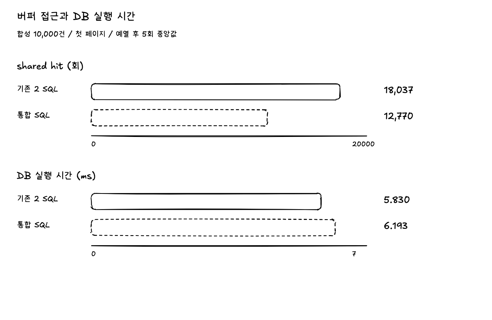

합성 데이터 첫 페이지의 버퍼 접근과 DB 실행 시간 비교

## 7. 너무 보수적인 설계였나? 중간 저장을 없애보자

정산할 예보를 가져올 때는 그 예측을 만든 차량과 수집 정보도 필요했다.\
관측 100에서 정류장 5와 6의 좌석을 예측했다면, 두 예보에 필요한 차량과 수집 정보는 같다.\
그래서 이 정보를 가져와 두 예보에 연결하고 있었다.

이 과정에서 대기 목록, 관측 ID 목록, 차량과 수집 정보, 정보를 연결한 예보를 각각 저장해뒀다.\
SQL에 붙인 `MATERIALIZED`가 이 결과를 보관하라는 뜻이다.\
별도 테이블에 남기는 건 아니고, 이 SQL이 실행되는 동안만 보관한다.

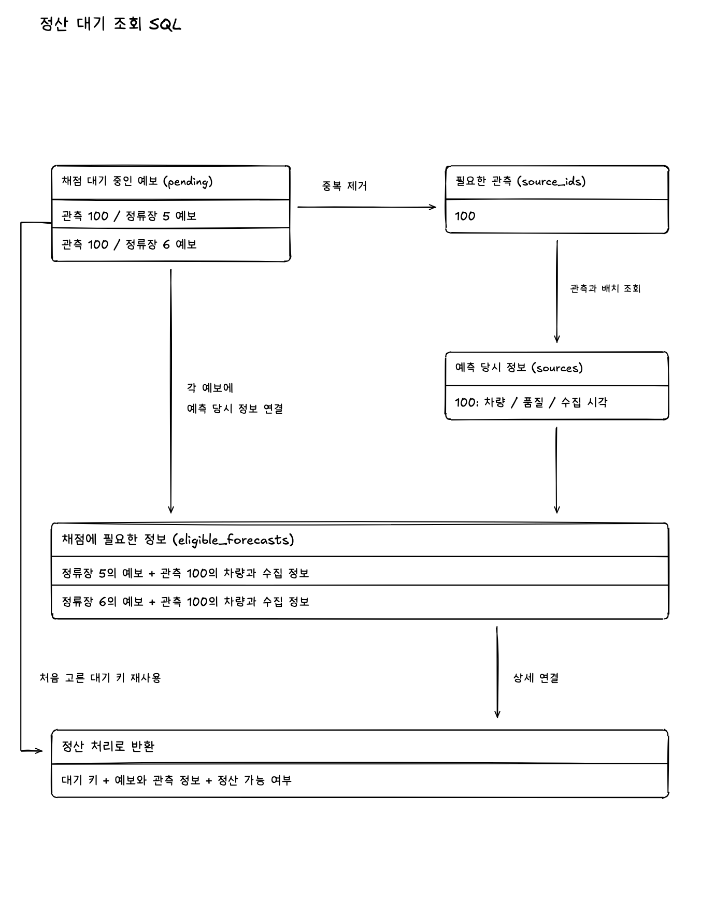

정산에 필요한 정보를 연결하면서 보관한 네 가지 결과

근데 저장해둔 결과 중에는 한 번만 사용하는 것도 있었다.\
한 번 쓸 결과라면 따로 저장하지 않아도 되지 않을까?

그래서 중간 저장을 없애고, 대기 목록에 필요한 정보를 바로 연결해봤다.\
근데 오히려 더 느려졌다.

실행 계획을 보니까 예보 1만 건을 먼저 연결하고 정렬한 다음, 이번에 처리할 대기 3,000건과 맞추고 있었다.

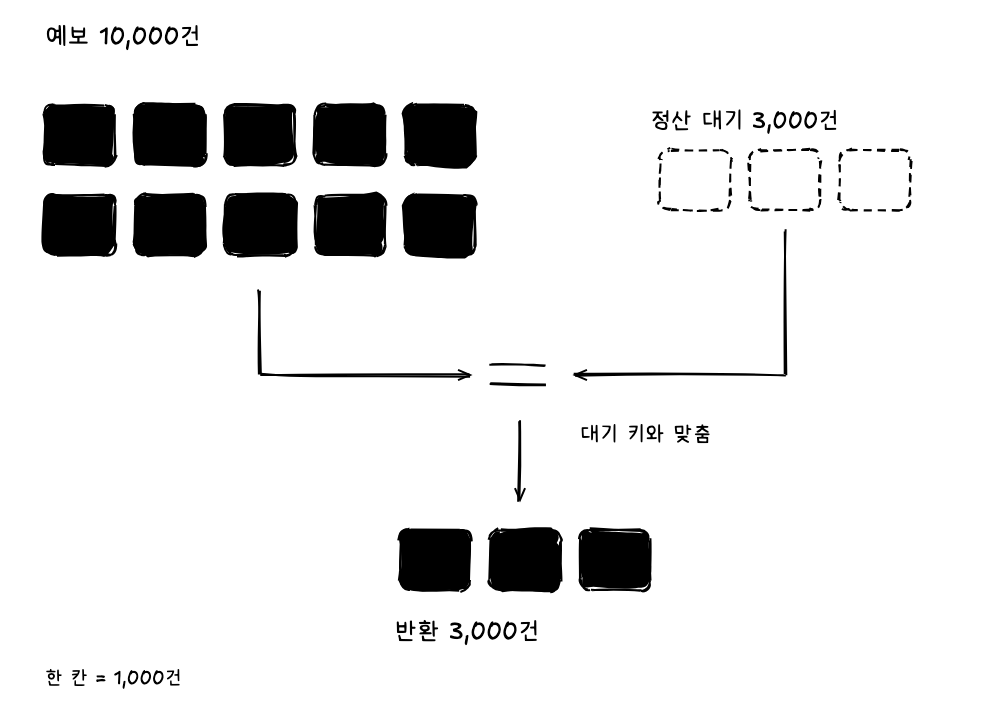

예보 1만 건을 먼저 처리한 뒤 대기 3천 건과 맞추는 흐름

필요한 건 3,000건인데, 그 전에 예보 1만 건을 처리하고 있었던 것이다.\
저장하는 작업을 줄이려고 SQL을 바꿨는데, 다른 작업이 늘어났다.

그래서 기존 SQL로 돌아갔다.\
이번에는 데이터를 연결하는 방식은 그대로 두고, 두 군데에서만 `MATERIALIZED`를 뺐다.

하나는 중복 없는 관측 ID를 구하는 곳이다.\
이 ID들은 차량과 수집 정보를 가져올 때 한 번만 사용했다.\
다른 하나는 예보에 필요한 정보를 붙이는 곳이다.\
이 결과도 마지막에 대기 목록과 맞출 때 한 번만 사용했다.

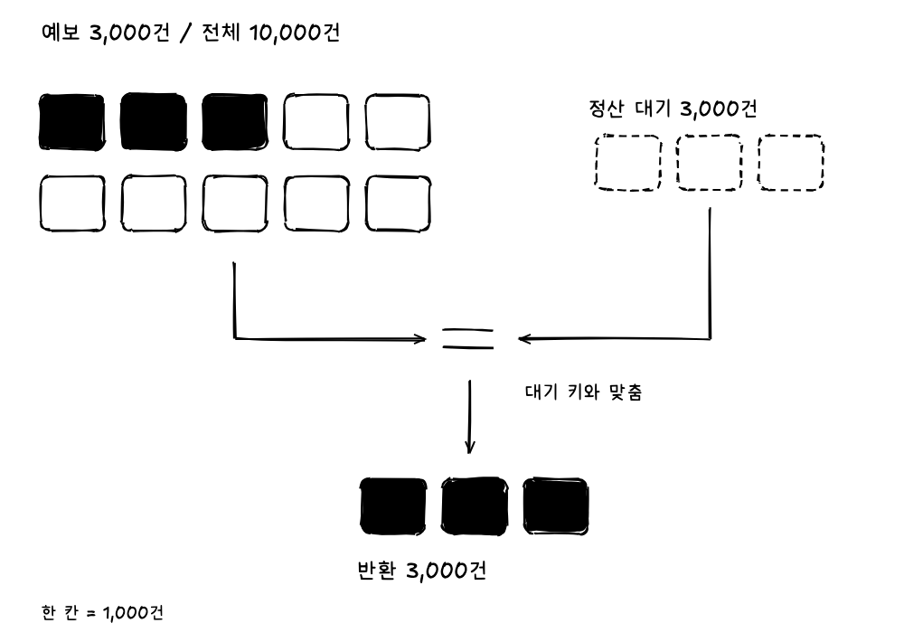

필요한 예보만 처리한 뒤 같은 대기 목록과 맞추는 흐름

실행 계획을 다시 보니 이번에는 필요한 예보 3,000건만 처리했다.\
근데 결과적으로 버퍼 접근은 같았고, 실행 시간도 큰 차이가 없었다. 저장을 줄이는 것만으로는 빨라지지 않았다.

## 8. SQL은 하나인데, 예보 인덱스 탐색은 3,000번?

차량과 수집 정보는 여러 예보에서 사용하도록 바꿨는데, 예보를 가져오는 쪽은 어떨까?\
실행 계획을 보니까 정산 대상 3,000건을 가져오려고 예보 인덱스를 3,000번 찾고 있었다.\
SQL을 3,000번 호출한 건 아니고, SQL 한 번 안에서 예보를 한 건씩 찾는 작업을 반복한 것이다.

관측 1에는 정류장 5부터 16까지 예보 12건이 있었다.\
기존 SQL은 관측 1과 정류장 5로 한 건을 찾고, 다시 관측 1과 정류장 6으로 다음 한 건을 찾았다.\
12건이 모두 대기 중이라면 같은 관측 ID로 정류장만 바꿔가며 12번 찾는 방식이었다.

같은 관측에서 만든 예보인데 한 번에 가져올 수 없을까?

그래서 관측 1에 속한 예보를 먼저 가져오도록 바꿨다.\
정류장 5부터 16까지 가져온 다음, 이번 대기 목록에 있는 정류장의 예보만 연결하는 것이다.

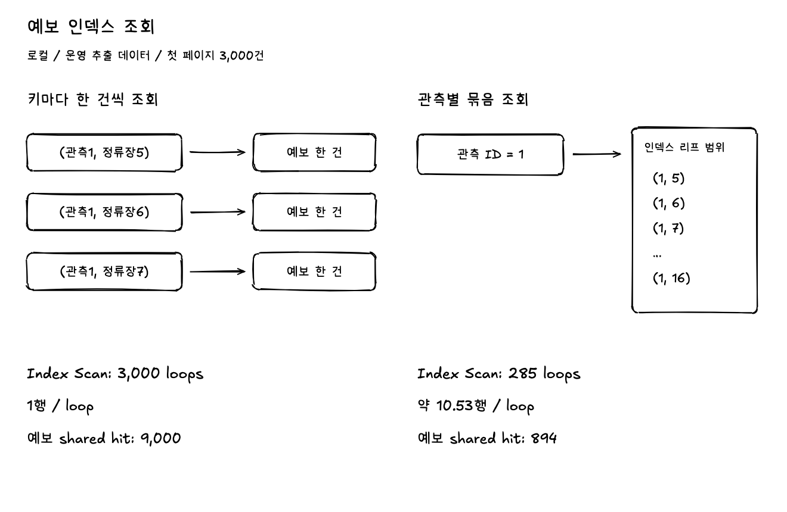

정류장마다 예보를 찾는 방식과 관측별로 가져오는 방식 비교

측정한 첫 페이지의 예보 3,000건은 관측 285건에서 만들어졌다.\
변경 후 실행 계획에서는 예보마다 찾는 대신 관측마다 가져왔다.\
인덱스를 찾는 횟수가 3,000번에서 285번으로 줄었고, 예보 조회의 버퍼 접근도 9,000회에서 894회로 줄었다.

근데 관측에 속한 예보를 가져오면 이번 대기 목록에 없는 것도 읽을 수 있다.\
이번에는 예보 3,001건을 읽었고, 대기 목록과 맞춰서 반환한 결과는 3,000건이었다.\
관측 하나에서 만드는 예보가 많아지면 추가로 읽는 양도 확인해야 한다.

## 9. 과연 효과는!

운영에서 추출한 예보 1만 건으로 로컬에서 비교했다.\
대기는 6,000건으로 구성하고, 한 번에 3,000건씩 가져왔다.\
기존 2개 SQL, 하나로 합친 SQL, 예보 조회까지 바꾼 SQL을 같은 스키마와 인덱스에서 실행했다.

먼저 결과가 같은지 확인했다.\
첫 3,000건과 그다음 3,000건을 가져왔을 때 키 순서와 모든 상세 값이 같았다.\
빈 결과와 페이지 크기를 바꾼 경우도 확인했다.

그다음 실행 순서를 바꿔가며 각각 18번씩 측정했다.\
첫 페이지의 조회 시간 중앙값은 기존 2개 SQL의 합계가 11.708ms, 하나로 합친 SQL이 8.747ms였다.\
예보 조회까지 바꾼 SQL은 5.186ms로, 합친 SQL보다 약 41% 빨라졌다.\
18번 중 16번에서 더 빨랐다.

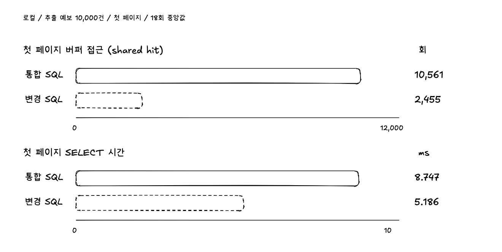

첫 페이지의 조회 시간과 전체 버퍼 접근 비교

근데 다음 페이지는 차이가 작았다.\
7.823ms에서 7.440ms로 약 5% 줄었고, 18번 중 13번에서 더 빨랐다.\
같은 SQL이어도 가져오는 데이터에 따라 시간 차이는 달랐다.

전체 SQL의 버퍼 접근도 첫 페이지는 10,561회에서 2,455회로, 다음 페이지는 10,560회에서 2,456회로 줄었다.\
두 페이지 모두 약 77% 감소했다.\
이건 메모리에 있는 데이터 페이지를 읽은 횟수이고, 디스크 읽기가 그만큼 줄었다는 뜻은 아니다.

이번 시간은 SQL을 보내고 결과를 받는 과정까지 포함했다.\
6번에서 측정한 DB 내부 실행 시간과는 범위가 다르다.

같은 결과를 가져오면서 반복 조회를 줄였고, 대부분의 측정에서 더 빨랐다.\
운영에서 정산 전체가 얼마나 빨라지는지는 반영 후 확인할 예정이다.
