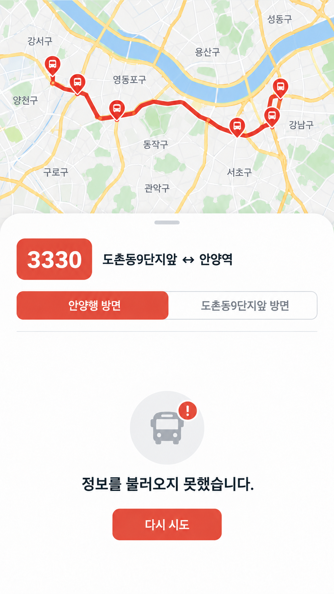
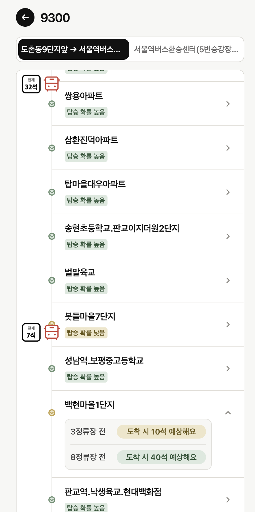
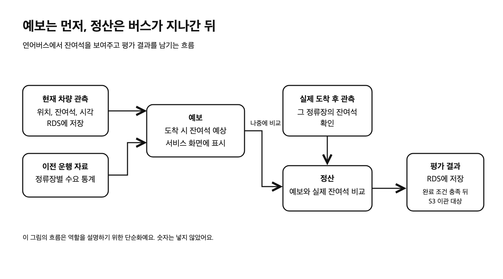
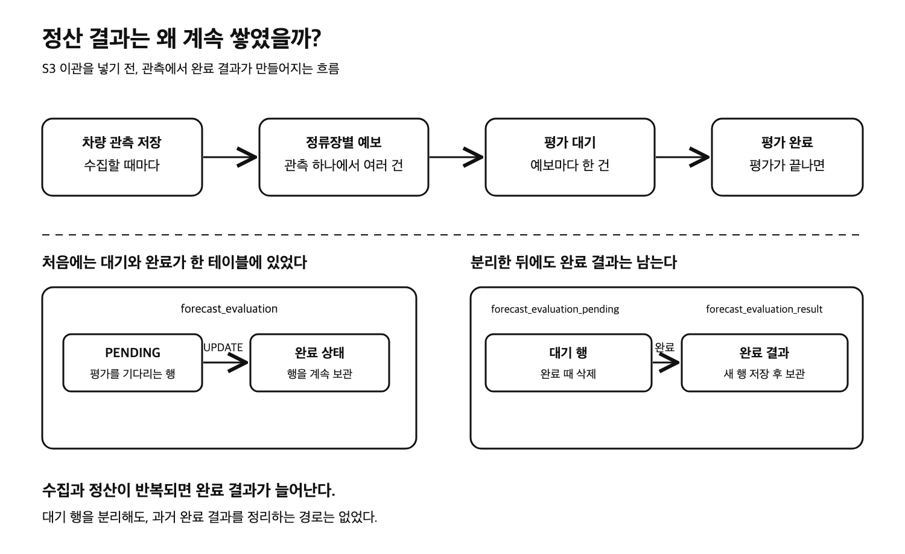
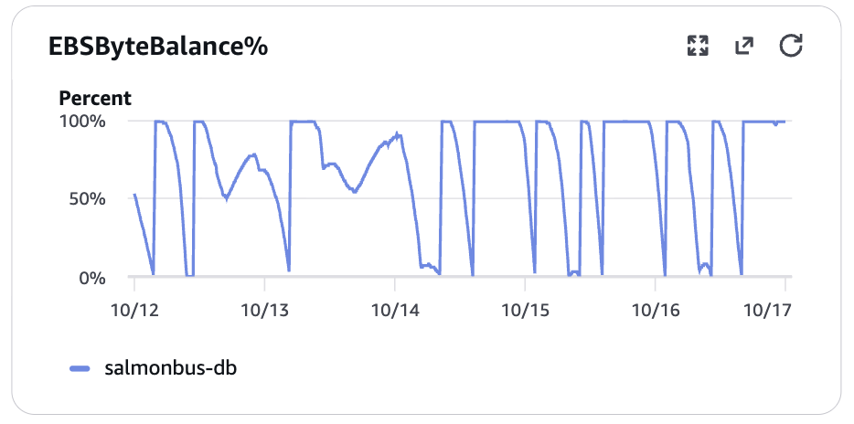
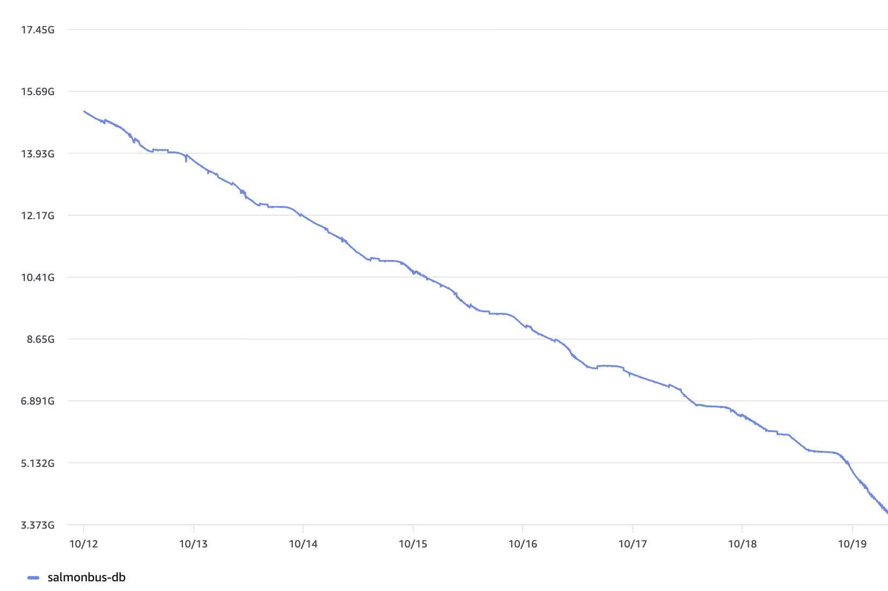

## 노선 12개를 더 추가해야 하는데, RDS는 자꾸 터짐...ㅜㅠ

수집 노선을 12개 더 추가할 예정이었다.
근데 이미 운영 RDS가 몇 차례 재시작했다.

버스 정보를 열었을 때
‘정보를 불러오지 못했습니다.’가 뜨기도 했다.



### 오류를 분석하기 전에,, 예보랑 정산이 뭔데?

연어버스는 지금 버스에 몇 석이 남았는지,
앞으로 정류장에 도착했을 때 몇 석이 남을지를 보여준다.



화면에는 지금 **32석**, **7석** 남은 버스가 보인다.
펼친 정류장에는 3정류장 전 버스가 도착할 때 **10석**,
8정류장 전 버스가 도착할 때는 **40석이 남을 것**이라고 나온다.
도착하기 전의 잔여석을 계산한 값이 예보다.

버스가 그 정류장을 지난 뒤에는 실제 잔여석을 확인하고,
앞서 만든 예보와 비교한다. 이 과정을 정산이라고 부른다.



## 우리 서비스는 데이터가 계속 쌓이기만 하는 구조였다...

버스 상태를 새로 받을 때마다 관측이 생긴다.
한 번 관측하면 앞으로 갈 정류장마다 예보를 만들고,
나중에 실제로 도착했을 때 비교할 수 있도록 평가 대기도 등록한다.

정산이 끝나면 그 결과를 RDS에 남긴다.

수집과 정산은 계속 반복되는데, 완료 결과를 정리하는 경로는 없었다.



10월 12일부터 16일까지의 운영 지표를 다시 봤다.
`EBSByteBalance%`는 RDS가 높은 스토리지 처리량을 쓸 때 소모하는 크레딧의 남은 비율이다.
이 값이 **0%까지 내려간 구간**이 여러 번 보인다. ([AWS 지표 설명](https://docs.aws.amazon.com/AmazonRDS/latest/UserGuide/rds-metrics.html))



RDS의 남은 저장 공간인 `FreeStorageSpace`도
10월 12일 약 15GB에서 19일 약 3.4GB까지 내려갔다.



크레딧이 0%까지 내려간 구간을 보고 RDS에서 어디를 많이 읽는지 확인했다.
평가 대기 목록과 상세를 찾는 조회가 많은 페이지를 읽고 있었다.
평가 테이블의 vacuum도 약 **23~24분마다** 실행됐고, 한 번에 약 **6GiB의 버퍼 읽기**가 기록됐다.
vacuum은 변경되거나 삭제된 행의 이전 버전을 정리하는 PostgreSQL 작업이다. ([앞선 조회 개선 PR](https://github.com/woowacourse-teams/2026-salmonbus/pull/95))

앞선 작업에서 대기 조회의 중복 읽기를 줄이고,
대기 중인 평가와 완료 이력을 다른 테이블로 나눴다.

근데 조회를 고쳐도 완료 결과는 정산할 때마다 `forecast_evaluation_result`에 추가된다.

완료 결과를 전부 RDS에 계속 쌓아둬야 할까?

## 어떤 데이터를 ‘지워도 되는 데이터’라고 정의할 수 있을까?

여기서 지우려는 건 RDS에 쌓인 완료 결과 행이다.
결과 자체는 과거 통계를 다시 계산할 수 있도록 S3에 보관해야 한다.

그럼 RDS에서는 언제 이 결과를 다시 읽을까?

버스 잔여석을 보여주는 화면은 과거 평가 결과를 직접 읽지 않는다.

하지만 정산 작업은 같은 예보가 이미 완료됐는지 확인한다.
완료 결과 행을 지우더라도 **끝난 평가라는 기록**은 남겨야 한다.
그렇지 않으면 같은 예보가 다시 대기로 등록될 수 있다.

그럼 정산만 끝난 행은 다 지워도 될까?

집계가 아직 끝나지 않은 결과는 RDS에 남아 있어야 한다.
오늘 정산한 결과도 마찬가지다. 좌석 수가 갑자기 튄 차량을 발견하면 품질 판정을 바꾸고 당일 통계를 다시 계산할 수 있다.

오래된 결과도 품질 판정이 나중에 바뀌면 다시 읽어야 한다.
그때는 RDS 대신 S3에서 가져오도록 만들 수 있다.

그래서 **한국 시간으로 오늘 이전에 정산과 집계가 끝났고**,
미처리 작업이나 재집계가 남지 않은 결과만 이관 대상으로 정했다.
도착 시각이 기록돼 있다면 그 시각도 오늘 이전이어야 한다.


차량 관측과 예보 원본은 이번 삭제 대상에 넣지 않았다.

## S3에 파일만 올리면 RDS 원본을 지워도 될까?

옮길 결과를 골랐으니 S3에 저장하고, 성공 응답이 오면 RDS에서 지우면 될 줄 알았다.

근데 업로드 성공만 확인하고 RDS에서 지웠다가,
나중에 내려받은 파일에서 결과가 빠져 있으면?

파일을 올리는 사이에 평가 결과나 품질 판정이 바뀌어도 처음 고른 행을 그대로 지워서는 안 된다.

그래서 먼저 짧은 DB 트랜잭션에서 이관할 묶음을 예약했다.
S3에 저장한 파일은 다시 내려받아 건수, SHA-256 해시, 각 결과의 내용과 품질 상태를 비교했다.
처음 예약한 작업이 여전히 그 묶음을 처리할 권한이 있는지도 확인했다.
하나라도 다르면 RDS 원본은 남긴다.

여기서 파일이 같다고 바로 지우지도 않았다.
삭제 직전에 RDS 원본과 처리 상태를 다시 읽었다.
그 사이 재집계가 시작됐거나 원본이 달라졌다면 삭제를 멈춘다.


S3 응답을 기다리는 동안 DB 트랜잭션을 열어두지 않았다.
파일 확인을 마친 뒤 짧은 트랜잭션에서 삭제 조건을 다시 확인하고,
**원본 삭제와 완료 기록 저장을 함께 확정**했다.

원본만 지워지고 완료 기록이 남지 않으면 이미 끝난 예보가 다시 평가 대기로 들어갈 수 있다.
반대로 완료 기록만 남고 S3 파일을 제대로 읽을 수 없다면 과거 통계를 다시 계산할 때 자료가 빠진다.

## DB에서 지운 결과가 다시 필요해지면?

평소에는 새로 들어온 평가 결과로 통계를 갱신한다.
근데 과거 결과의 품질 판정이 바뀌어 통계를 다시 계산해야 할 때는?

RDS에 어떤 결과를 어느 S3 파일로 옮겼는지, 파일 건수와 해시가 무엇인지 남겼다.
통계를 다시 계산할 때 이 기록으로 필요한 파일을 찾고, RDS에 남은 결과와 S3에서 읽은 결과를 합친다.
계산한 통계는 다시 RDS에 저장한다.


이때 DB 원본 전체를 복구하지는 않는다.
통계 계산에 필요한 결과만 읽고, 어디까지 처리했는지 기록하는 진행 위치는 RDS에 남긴다.

## S3 응답이 늦으면 버스 정보 수집도 기다려야 하나?

통계와 이관 작업이 S3 응답을 기다릴 때, 차량 정보 수집과 실시간 예측까지 멈추게 하고 싶지는 않았다.

그래서 통계와 이관을 별도 스레드에서 실행했다. 스레드는 같은 worker 안에서 작업을 따로 실행하는 흐름이다.

```text
collection 스레드  → 수집
processing 스레드  → 실시간 예보와 평가
calibration 스레드 → 통계와 이관
```

그럼 이제 DB 부하도 분리된 걸까?

아니다. 세 작업은 같은 worker, 같은 DB 연결 묶음인 Hikari 연결 풀, 같은 RDS를 사용한다. 스레드를 나눠도 DB 연결과 저장 장치 입출력(I/O)까지 따로 생기지는 않는다.


그래서 SQL 실행은 500ms, 잠금 대기는 100ms, DB 트랜잭션은 2초로 제한했다. S3 작업이 실패하면 DB 원본을 유지하고, 60초 뒤 만료된 작업부터 다시 시작한다.

## 두근두근..결과는!

10월 17일 19:26(한국 시간), 완료된 평가 결과를 S3로 옮기기 시작했다.
이때는 RDS 원본을 지우지 않았다.
원본 삭제는 19일 18:28부터 시작됐고, 한 번에 최대 100행씩 처리했다.

참고로 그 사이 수집 대상 노선이 12개 늘어 20개가 됐다.
운영 모델도 20개 노선의 예보를 만들고 있었다.

19일 19:30부터 20:30까지 운영 로그를 합쳐봤다.
정산 완료 결과는 **498,241건**이었다.
그중 추가한 12개 노선에서 **234,757건**이 나왔다. 비율로는 **47%** 정도다.

같은 한 시간 동안 S3 이관 후 RDS에서 지운 결과는 **31,100건**이었다.
완료 결과 테이블과 인덱스의 크기는 약 **16.47GB에서 16.58GB**로, 약 **110MB** 늘었다.

추가한 12개 노선에서도 예보와 정산을 처리했고, 이관도 RDS 원본을 지웠다.
하지만 완료 결과는 지우는 속도보다 빨리 쌓였다.
한 번에 이관할 행 수와, 상세 평가 결과를 어디까지 RDS에 남겨야 할지는 아직 더 고민해봐야 한다.
