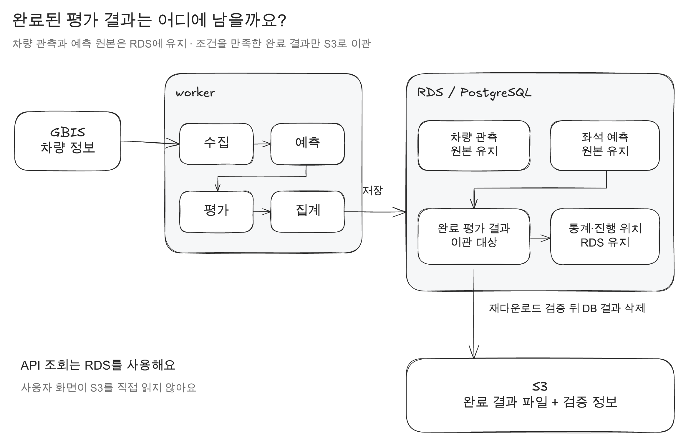
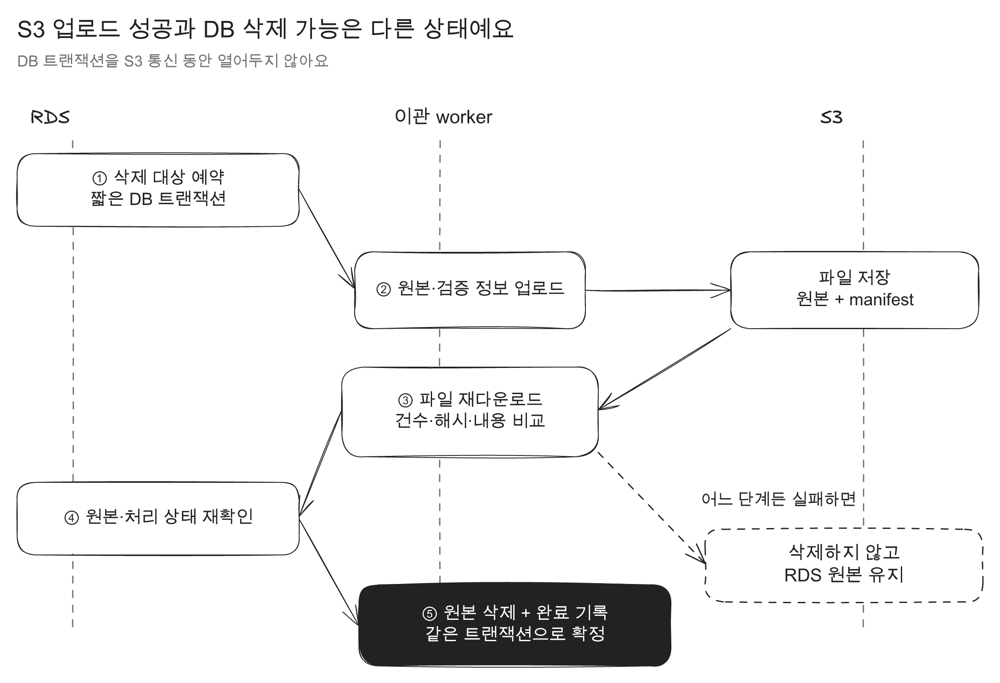
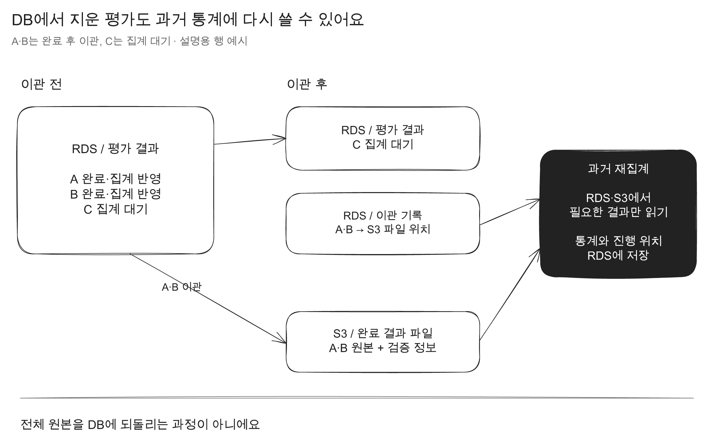
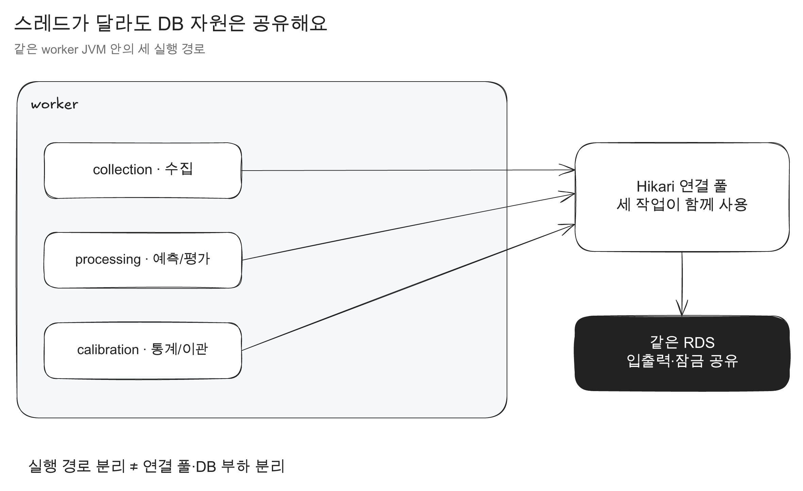

연어버스는 버스의 잔여석을 예측하고, 실제 잔여석과 얼마나 달랐는지도 기록해요. 이 평가 결과는 이후 예측을 보정하거나 과거 통계를 다시 계산할 때 필요해요.

노선을 12개 더 늘릴 예정이었는데, 평가가 끝난 결과도 Amazon RDS의 PostgreSQL DB에 계속 쌓이고 있었어요. 대기 중인 평가와 완료 이력을 나눠 조회 비용은 줄였지만, 완료 결과를 계속 같은 DB에 보관하면 테이블과 인덱스는 다시 커져요.

그래서 집계가 끝난 과거 평가 결과를 파일 저장소인 Amazon S3로 옮긴 뒤 RDS에서 삭제하는 흐름을 만들었어요.

처음에는 S3 업로드만 성공하면 DB 원본을 지워도 될 것 같아요. 근데 이 데이터는 과거 통계를 다시 계산할 때 읽어요. 이미 끝난 평가가 다시 대기 상태로 등록되는 것도 막고 있고요. **저장 장소만 바꾸는 게 아니라, 다시 읽는 방법과 완료 여부를 판단하는 방법까지 바꿔야 했어요.**

## 어떤 데이터를 옮길까요?

연어버스는 외부에서 받은 차량 상태를 시각과 함께 저장해요. 이 기록을 관측이라고 해요. 관측 하나에서 앞으로 도착할 여러 정류장의 잔여석을 예측하고, 버스가 실제로 도착하면 예측과 실제 잔여석을 비교해 평가 결과를 만들어요.

이번에 S3로 옮기는 것은 조건을 만족한 완료 평가 결과예요. 차량 관측과 예측 원본은 RDS에 그대로 남겨요. 사용자 화면도 S3를 직접 조회하지 않아요.



RDS에서 삭제하려면 아래 조건을 모두 만족해야 해요.

- 한국 시간 기준 오늘 이전에 평가가 끝남
- 집계가 끝남
- 미처리 작업이나 재집계가 남아 있지 않음
- 도착 시각이 있다면 도착도 오늘 이전임

오늘 자료까지 바로 옮기면 품질 판정이 바뀌었을 때 통계를 다시 계산하기가 복잡해져요. 그래서 평가와 집계가 끝났는지만 보지 않고, 아직 DB에서 다시 읽어야 할 작업이 있는지도 확인했어요.

## S3에 저장했는데 DB 원본을 바로 지워도 될까요?

안 돼요. 업로드 요청이 성공했다는 사실만으로 파일 내용이 DB 원본과 같은지는 알 수 없어요. 삭제 직전에 원본의 처리 상태가 바뀌었을 수도 있고요.

그래서 아래 순서로 처리했어요.

1. 이관할 대상을 짧은 DB 트랜잭션에서 예약
2. 원본과 검증 정보를 S3에 저장
3. 저장한 파일을 다시 내려받음
4. 건수, SHA-256 해시, 원본 내용, 품질 상태, 소유권을 비교
5. 삭제 직전에 현재 원본과 처리 상태를 다시 확인
6. DB 원본 삭제와 삭제 완료 기록을 같은 트랜잭션으로 커밋

SHA-256은 파일 내용으로 계산하는 값이에요. 저장한 파일을 다시 내려받아 계산한 값이 다르면 같은 파일이라고 볼 수 없어요. 해시만 보지 않고 건수와 각 원본의 내용, 품질 상태도 비교했어요.

S3 통신을 기다리는 동안 DB 트랜잭션을 열어두지는 않았어요. 트랜잭션은 여러 DB 변경을 한 번에 확정하거나 취소하는 단위예요. 파일 검증이나 삭제 직전 재확인 중 하나라도 실패하면 원본은 RDS에 남아요.



원본 삭제와 완료 기록도 같은 트랜잭션으로 묶었어요. 삭제만 되고 완료 기록이 남지 않으면 같은 평가가 다시 대기로 등록될 수 있어요. 반대로 완료 기록만 있고 S3 파일을 제대로 읽을 수 없다면 과거 통계를 계산할 때 자료가 빠져요.

## DB에서 삭제한 결과는 어떻게 다시 읽을까요?

정기 통계 갱신은 새로 들어온 평가 결과만 반영해요. 과거 결과의 품질 판정이 바뀌어 통계를 다시 계산할 때는 RDS에서 삭제한 평가 결과를 S3에서 다시 읽어요.

RDS에는 어떤 평가를 어느 S3 파일로 옮겼는지, 파일 건수와 해시가 무엇인지 남겨요. 통계를 다시 계산할 때는 현재 품질 조건에 필요한 평가를 먼저 찾고, RDS와 S3의 결과를 합쳐요. 계산한 통계는 다시 RDS에 저장해요.



S3 파일을 읽는다고 DB 원본 전체를 복구하는 건 아니에요. 통계 계산에 필요한 결과만 읽고, 어떤 조건까지 처리했는지 기록하는 진행 위치는 RDS에 유지해요.

## 작업 스레드를 나누면 DB 부하도 나뉠까요?

그렇지는 않아요. 그래도 S3 응답을 기다리는 동안 차량 정보 수집과 실시간 예측이 멈추지 않도록 통계와 이관 작업을 별도 실행 경로로 나눴어요. 스레드는 같은 프로그램 안에서 작업을 실행하는 흐름이에요.

```text
collection 스레드  → 수집
processing 스레드  → 실시간 예보와 평가
calibration 스레드 → 통계와 이관
```

근데 세 작업은 같은 worker 프로그램, 같은 DB 연결 묶음인 Hikari 연결 풀, 같은 RDS를 사용해요. 스레드를 나눴다고 DB 연결과 저장 장치 입출력(I/O)까지 분리되는 건 아니에요.



그래서 SQL 실행은 500ms, 잠금 대기는 100ms, DB 트랜잭션은 2초로 제한했어요. S3 작업이 실패하면 DB 원본을 유지하고, 60초 뒤 만료된 작업부터 다시 시작해요.

## 파일이 다르거나 작업이 실패하면 어떻게 될까요?

가장 조심한 순간은 S3 업로드가 성공한 뒤 DB 원본을 삭제할 때였어요. 업로드 성공은 파일을 다시 읽을 수 있다는 뜻이 아니고, 파일을 확인한 직후에도 원본의 처리 상태는 바뀔 수 있어요. 그래서 재다운로드 검증과 삭제 직전 재확인을 별도 단계로 뒀어요.

테스트에서는 내려받은 파일이 원본과 다르면 DB 원본이 남는지 확인했어요. 작업이 중간에 실패하면 다시 실행할 수 있었고, 일부 자료만 읽은 통계는 게시하지 않았어요. RDS에서 이미 삭제한 결과는 S3에서 읽어 현재 DB 자료와 합친 뒤 진행 위치를 저장했고, 복원한 결과를 다시 삭제하지 않는 동작도 확인했어요. 삭제, 자동 처리, 스레드 구성을 다루는 테스트도 통과했어요.

삭제를 멈추는 동작과 과거 자료를 읽는 동작은 분리했어요. 과거 통계에는 이미 S3로 옮긴 결과가 필요하니까요. 삭제 작업만 멈출 때는 `FORECAST_ARCHIVE_DELETE_ENABLED=false`로 바꾸고 worker를 재시작하도록 했어요. **파일을 확인하고 원본을 지우는 순간뿐 아니라, 그 뒤에도 같은 결과를 다시 읽을 수 있어야 이관이 끝난 거예요.**

구현과 테스트 내용은 [PR #97](https://github.com/woowacourse-teams/2026-salmonbus/pull/97)에 남겨뒀어요.
