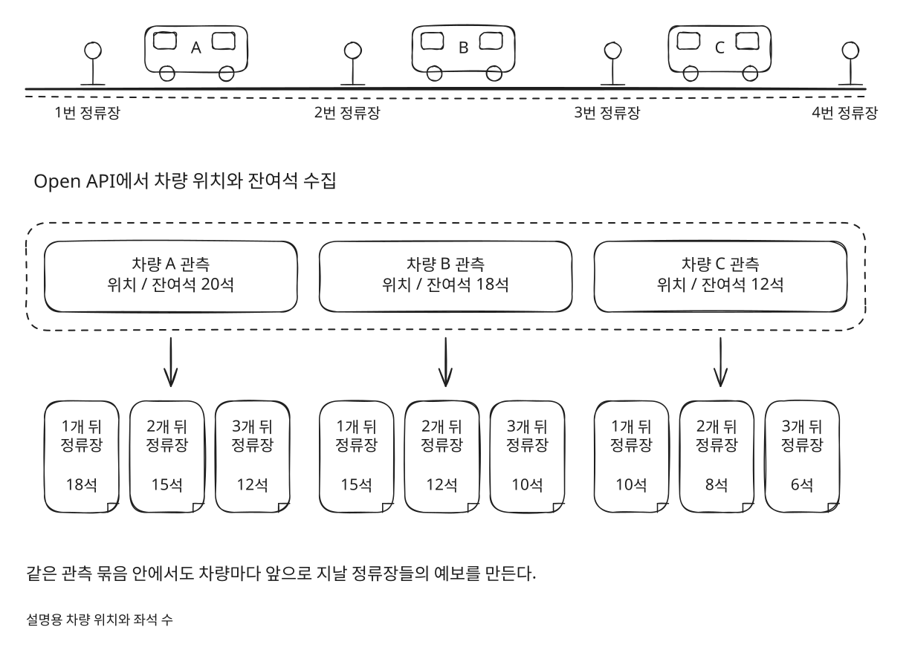
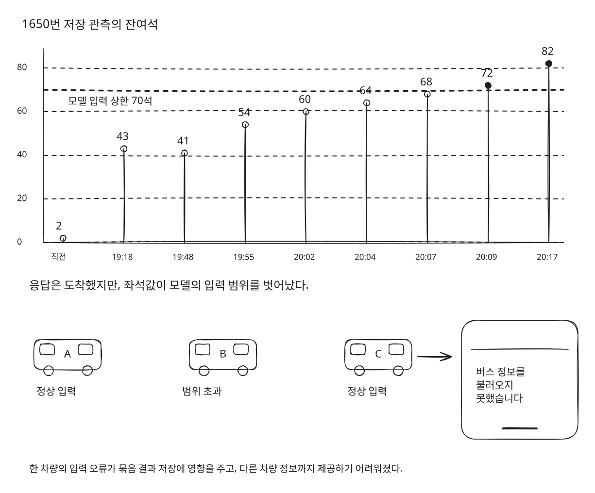
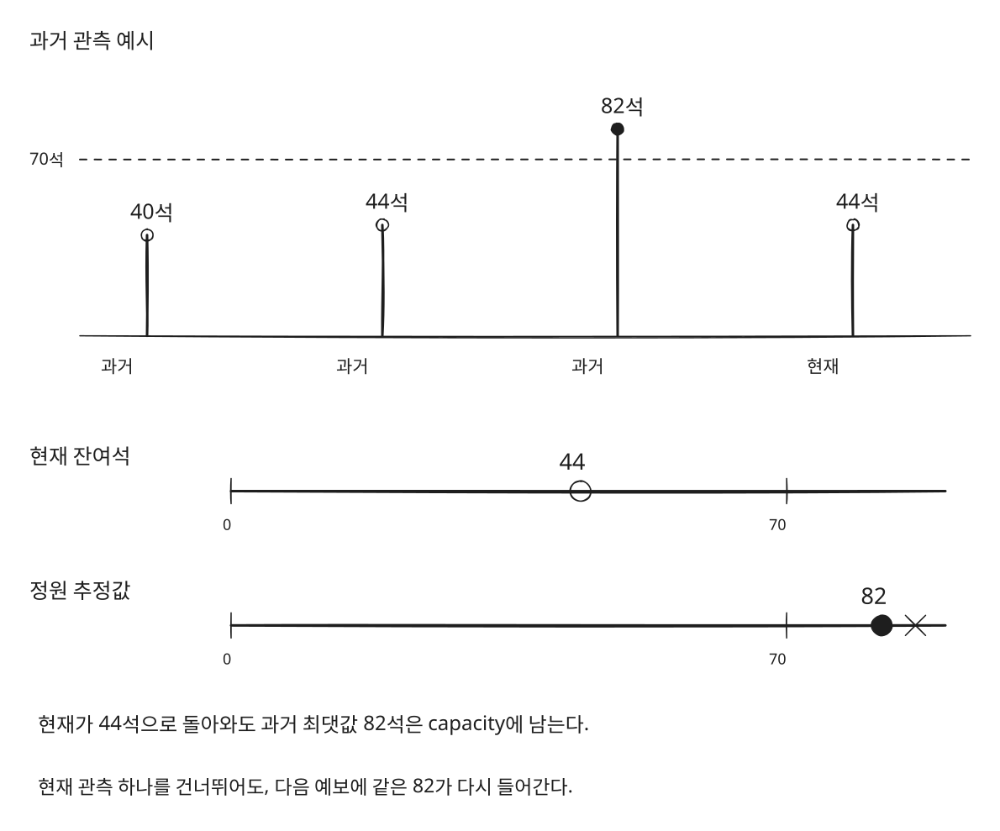
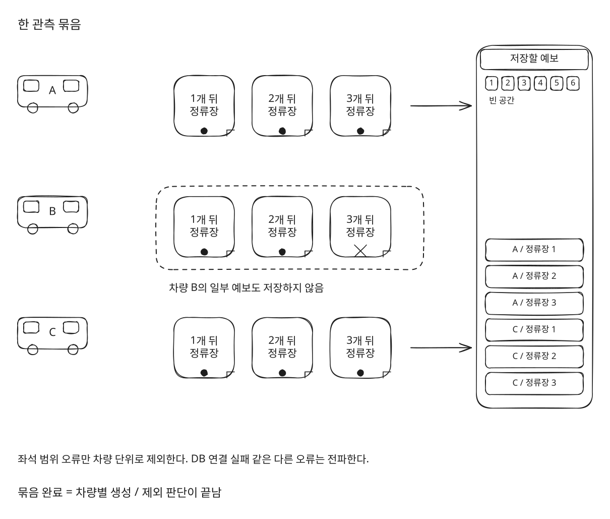
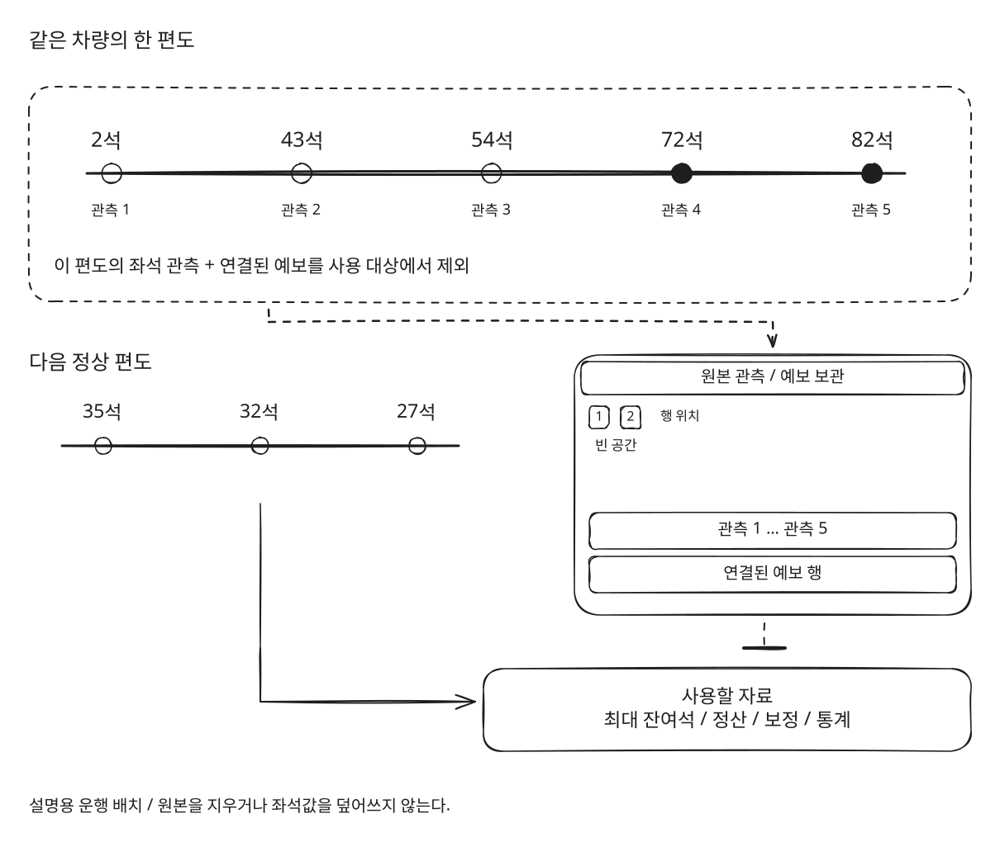
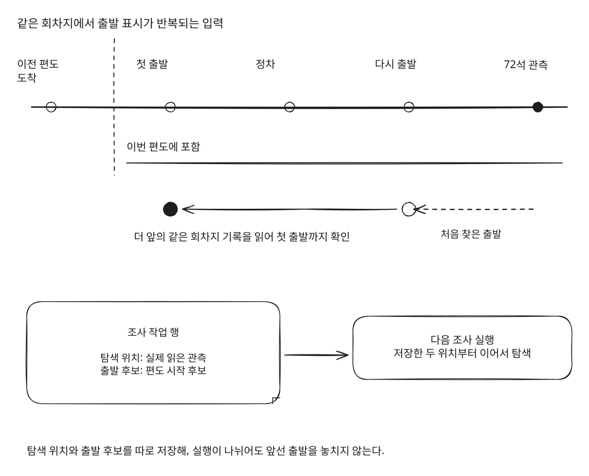
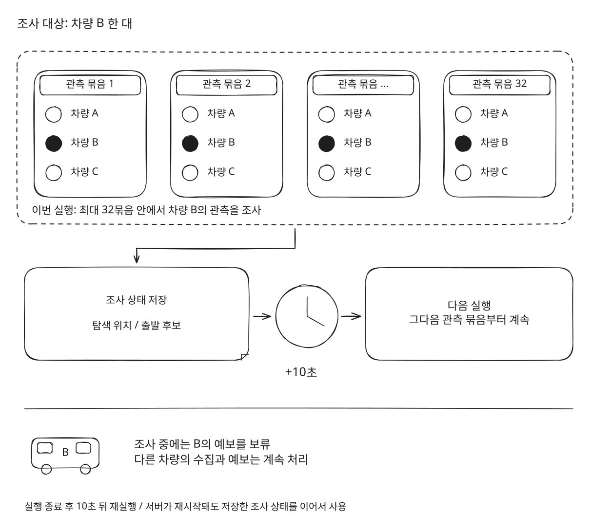
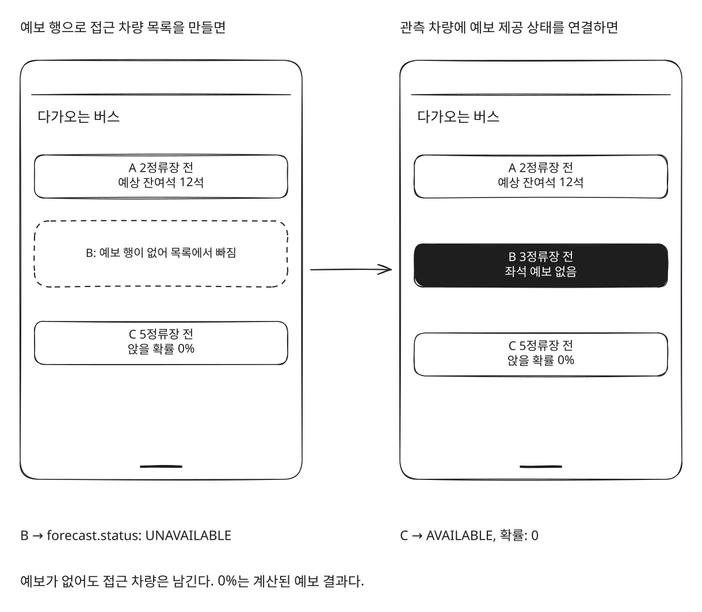
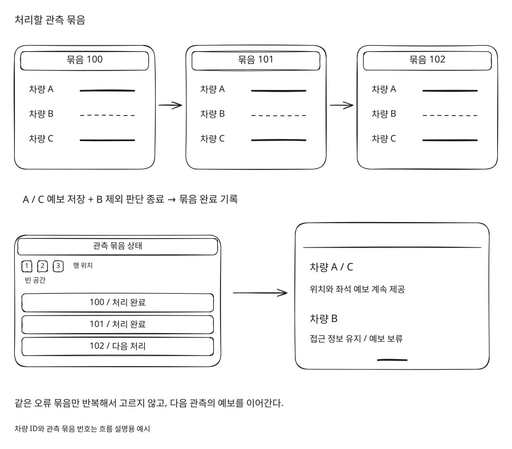

## 0. 여러 버스의 예보는 어떻게 만들어질까?

연어버스는 버스가 내가 탈 정류장에 도착했을 때, 자리가 얼마나 남아 있을지 알려주는 서비스다.

이를 위해 Open API에서 차량의 현재 위치와 잔여석을 가져온다. 이때 수집한 데이터를 **관측**이라고 부른다.

관측이 들어오면 차량별로 지금까지의 이동을 확인하고, 앞으로 지날 정류장의 잔여석을 예측한다.

설명용으로 버스 A가 현재 3번 정류장에 있다고 해보자.

```text
현재 위치: 3번 정류장
현재 잔여석: 20석

4번 정류장 도착 시 → 18석 예상
5번 정류장 도착 시 → 15석 예상
6번 정류장 도착 시 → 12석 예상
```

이렇게 한 차량에서도 여러 정류장의 예보가 만들어진다.

실제로는 차량 한 대만 수집하는 것이 아니다. 한 번의 수집으로 여러 차량의 관측이 들어오고, 그 묶음 안에서 차량별 예보를 계산한다.



이번 문제는 이 중 **차량 한 대의 잔여석**에서 시작됐다.

## 1. 한 대의 잔여석이 이상한데, 왜 다른 차량까지 안 보이지?

Open API를 사용하면서 네트워크가 끊기거나, 요청이 실패하거나, 응답이 늦게 오는 상황은 생각하고 있었다.

근데 응답은 정상적으로 왔는데, 그 안에 우리 모델이 처리할 수 없는 값이 들어온다면?

**네트워크 같은 문제는 고려했어도 Open API에서 애초에 잘못된 값을 주는 건 예상 못했다...!**

저장된 관측을 찾아보니 잔여석이 이렇게 변하고 있었다.

```text
직전 관측   2석
19:18      43석
19:48      41석
19:55      54석
20:02      60석
20:04      64석
20:07      68석
20:09      72석
20:17      82석
```

2석에서 43석으로 늘어난 것만 보면, 승객이 한꺼번에 내렸을 수도 있다.

그런데 이후에는 72석, 82석까지 올라갔다. 우리 예보 모델이 지원하는 좌석 범위는 최대 70석이었다.

여기서 70석은 모든 버스의 실제 정원을 뜻하지 않는다. **우리 모델이 계산할 수 있도록 정해둔 입력 범위**다.

범위를 벗어난 값이 모델에 들어가면 예외가 발생한다.

문제는 그 예외를 차량 한 대의 문제로 처리하지 못하고 있었다는 점이다.

```text
차량 A 예보 계산
→ 차량 B에서 좌석 범위 오류
→ 뒤 차량의 계산과 묶음 결과 저장까지 영향
```

사용자는 차량 B의 데이터에 문제가 생겼다는 사실을 알 수 없다.

그냥 다른 버스의 정보까지 보이지 않는다.



**B 한 대의 예보를 못 만드는 건 이해하겠는데, A랑 C까지 못 보여줄 이유가 있을까?**

우선 이 실패가 어디까지 영향을 주는지부터 확인해야 했다.

## 2. 잔여석이 정상으로 돌아왔는데, 왜 계속 실패할까?

처음에는 범위를 벗어난 관측 하나를 건너뛰면 될 것 같았다.

82석이 들어오면 그 관측은 예보에 사용하지 않고, 다음에 정상 범위의 값이 들어왔을 때 다시 계산하면 되지 않을까?

근데 모델에 들어가는 값은 현재 잔여석만이 아니었다.

모델은 차량의 정원을 추정할 때, **그 차량에서 과거에 관측한 최대 잔여석**을 사용하고 있었다.

```text
capacity = 사용 가능한 과거 잔여석 중 최댓값
```

설명용으로 다음 관측에서 잔여석이 44석으로 돌아왔다고 해보자.

```text
현재 잔여석: 44석
과거 최대 잔여석: 82석

모델 입력
→ 현재 잔여석 44
→ 정원 추정값 82
```

현재값은 모델 범위 안에 있다.

하지만 과거 최대값으로 82가 들어가므로, 정원 추정값을 검사하는 곳에서 다시 실패한다.



**지금 들어온 값만 건너뛰어서는 다음 예보도 만들 수 없는 구조였다.**

이미 저장된 관측은 이후 처리에서도 사용되고 있었다.

예보를 만들 때 과거 자료를 읽고, 실제 도착 관측과 예보를 연결해 정산한다. 그 결과는 다시 당일 보정과 통계, 학습 자료에 들어간다.

그러니 두 가지를 따로 해결해야 했다.

1. 문제 차량 때문에 다른 차량의 예보까지 제공하지 못하는 상황
2. 저장된 문제 자료가 다음 예보와 정산에 다시 들어가는 상황

## 3. 예외는 어디서 잡아야 다른 차량을 계속 보여줄 수 있을까?

먼저 차량별 예보 계산 경계에서 좌석 범위 오류를 잡도록 했다.

한 차량의 계산이 끝나면 그 결과를 전체 저장 목록에 합치는 구조다.

```text
차량 A → 계산 성공 → 저장 목록에 추가
차량 B → 좌석 범위 오류 → 예보 제외
차량 C → 계산 성공 → 저장 목록에 추가
```

모든 예외를 잡지는 않았다.

DB 연결에 실패했거나 설정이 잘못됐는데, 그것까지 “이 차량은 예보가 없어요”로 처리하면 실제 장애를 숨기게 된다.

그래서 좌석 입력 범위 오류를 별도의 `SeatRangeException`으로 구분하고, 이 예외만 차량별 계산 경계에서 처리했다.

여기서 한 가지 더 생각할 것이 있었다.

차량 B에서도 정류장별 예보를 순서대로 만들기 때문에, 앞쪽 정류장은 성공하고 뒤쪽 정류장에서 실패할 수 있다.

```text
차량 B
├─ 4번 정류장 예보 성공
├─ 5번 정류장 예보 성공
└─ 6번 정류장 예보 실패
```

앞에서 만든 두 건은 저장해도 될까?

이번에는 **차량 한 대의 예보를 모두 만든 뒤에 저장 목록에 합치도록 했다.** 중간에 범위 오류가 나면 그 차량의 일부 예보도 저장하지 않는다.



관측 묶음의 처리 완료 기준도 구분했다.

완료는 “모든 차량의 예보를 성공적으로 만들었다”는 뜻이 아니다.

각 차량을 계산하거나 제외하는 판단이 끝났다면 그 묶음은 처리한 것이다. 그래야 같은 오류 묶음을 계속 선택하면서 뒤의 관측까지 처리하지 못하는 상황을 피할 수 있다.

## 4. 70석을 넘은 관측만 빼면 되는 것 아닐까?

다른 차량을 계속 처리하도록 바꿨으니, 이제 문제 자료가 다시 사용되는 것을 막아야 했다.

가장 단순하게는 70석을 넘은 관측만 제외할 수 있다.

근데 앞의 기록에는 43, 54, 60, 64, 68석도 있었다.

이 값들은 모델 범위 안에 들어간다. 그렇다고 모두 정상이라고 판단해도 될까?

같은 운행 중 어떤 이유로 좌석값이 달라지기 시작했다면, 70석 이하의 값에도 같은 영향이 있을 수 있다. 반대로 2석에서 43석으로 늘어난 시점부터 전부 잘못됐다고 정할 수도 없다. 실제로 승객이 많이 내렸을 가능성이 있기 때문이다.

**잘못된 값이 정확히 어디서 시작됐는지를 정하는 것보다, 그 자료를 어디까지 다시 사용하지 않을지 정해야 했다.**

그래서 범위를 벗어난 좌석값을 발견하면, 그 차량의 **해당 편도 전체 좌석 관측과 연결된 예보**를 사용 대상에서 제외하기로 했다.

편도는 한쪽 출발지에서 반대쪽 종점까지 가는 한 번의 운행이다.

차량의 모든 과거 기록을 제외하는 것은 아니다. 다른 차량과 다음 정상 편도의 자료는 유지한다.

원본 관측과 예보 행도 삭제하지 않았다.

나중에 다시 조사할 수 있도록 원본은 남기고, 사용할 수 있는 자료인지를 별도로 관리했다.

이 상태는 과거 최대 잔여석을 구할 때뿐 아니라 다음 조회에도 적용했다.

- 예측 입력
- 기존 예보 조회
- 실제 도착 관측과 예보의 연결
- 당일 보정과 통계
- 학습용 자료 조회



정상일 수 있는 값도 일부 제외하는 선택이다. 대신 같은 운행에서 나온 문제 자료가 예보와 정산에 계속 들어가는 것을 막는 쪽을 택했다.

## 5. 근데 그 버스가 어디서 출발했는지는 어떻게 알지?

편도 전체를 제외하기로 하니, 이번에는 그 편도가 어디서 시작됐는지 알아야 했다.

기점의 출발 기록부터 찾으면 될 것 같지만, 수집된 자료에는 출발 표시가 없는 경우도 있었다.

당시 확인한 6시간 표본에서 1650번의 기점 출발 표시는 0건이었다. 두 노선 모두 마지막 정류장 관측도 없었다.

출발 기록 하나만 필수 조건으로 삼으면 편도를 찾지 못할 수 있었다.

그래서 출발 표시와 정류장 순서, 방향 전환을 같이 봤다.

버스가 노선 끝부분에서 앞부분으로 이동했는지, 기점이나 회차지에서 출발 상태가 나타났는지를 연결해서 판단했다. 관측 사이의 시간 간격도 함께 사용했다.

시간 기준을 너무 짧게 잡아도 문제였다.

실제 표본에는 차량별 관측 간격 중앙값이 1분을 넘는 시간대가 있었다. 1분만 지나도 연결을 끊으면 정상 운행도 계속 나뉠 수 있다.

우선 기본 연결 제한을 10분으로 두고, 출발이나 방향 전환이 있으면 이를 먼저 새 편도의 근거로 사용했다.

그런데 리뷰에서 또 다른 경우가 나왔다.

```text
같은 회차지에서

출발
→ 정차
→ 다시 출발
→ 이후 정류장에서 72석 관측
```

이 입력을 테스트로 만들어보니, 과거로 거슬러 올라가던 코드가 두 번째 출발에서 멈췄다.

그러면 첫 출발과 중간 정차 관측은 제외 범위 밖에 남는다. 그 값들이 70석 이하라면 범위 검사에도 걸리지 않고 다시 사용될 수 있다.

**출발 표시를 찾았다고 바로 탐색을 끝내면 안 되는 경우였다.**

수정 후에는 두 위치를 따로 관리했다.

- 실제로 어디까지 과거 관측을 읽었는지
- 그중 어디가 편도 시작 후보인지

같은 회차지의 앞선 기록을 더 읽으면서 첫 출발을 찾고, 이전 편도의 도착 관측은 포함하지 않도록 했다.



## 6. 이걸 모든 차량에 매번 확인하면 DB가 더 힘들지 않을까?

편도 경계를 판정하는 로직을 만들었다고, 모든 관측이 들어올 때마다 실행하면 될까?

그렇게 하면 문제가 없는 차량에도 계속 과거 조회와 편도 저장 작업이 추가된다.

정상적인 수집이 대부분인데, 드물게 발생하는 좌석 오류를 처리하려고 매번 DB 작업을 늘리고 싶지는 않았다.

그래서 **정상 수집 경로에서는 이미 가져온 관측의 차량 ID와 잔여석을 확인하고, 범위를 벗어난 차량만 조사 요청을 남기도록 했다.**

과거 자료 조사는 별도 작업에서 조금씩 처리한다.

```text
범위를 벗어난 좌석 발견
→ 해당 차량의 예보 보류
→ 조사 요청 등록
→ 과거 관측을 제한된 양으로 조회
→ 다음 실행에서 이어서 조사
```

기본 실행 간격은 앞선 실행이 끝난 뒤 10초로 두었다.

한 번에 차량 한 대를 조사하고, 읽는 범위는 최대 32개 관측 묶음으로 제한했다. 차량 관측 32행이 아니라, 수집한 묶음 32개다.

이렇게 하면 대상 차량이 과거 자료에서 한동안 나타나지 않아도 한 번의 실행이 끝없이 읽지 않는다.

대신 조사가 끝날 때까지 그 차량의 예보는 보류한다.

한 번에 빨리 끝내는 것보다 정상 차량의 수집과 예보 처리를 계속 이어가는 쪽을 우선했다.

앞에서 나눈 탐색 위치와 출발 후보도 DB에 저장했다. 조사 도중 실행이 끝나거나 서버가 재시작돼도, 다음 실행에서 같은 위치부터 이어갈 수 있도록 했다.



## 7. 예보를 못 만든다고 버스까지 화면에서 사라져야 할까?

여기까지 바꿨는데, API에서도 하나를 더 구분해야 했다.

기존에는 예보 행을 기준으로 접근 차량 목록을 만들고 있었다.

이 구조에서는 예보를 만들지 못한 차량이 목록에서도 빠진다.

근데 버스는 실제로 오고 있다.

우리가 모르는 것은 그 버스가 도착했을 때 남아 있을 좌석이지, 버스가 접근 중이라는 사실까지 모르는 것은 아니다.

그래서 차량 관측을 기준으로 접근 차량을 유지하고, 예보 제공 여부를 별도로 응답하도록 바꿨다.

```json
{
  "forecast": {
    "status": "UNAVAILABLE"
  }
}
```

예보가 있으면 `AVAILABLE`과 예측값을 반환한다.

여기서 **앉을 확률 0%와 예보 없음도 구분해야 한다.**

0%는 계산한 결과다. 예보 없음은 계산 결과를 제공할 수 없는 상태다.

예보를 못 만들었다고 0%를 넣어버리면, 사용자는 “예측을 못 했구나”가 아니라 “앉을 수 없구나”라고 이해하게 된다.



현재 잔여석과 도착 시점의 예보도 같은 값이 아니다.

그래서 예보를 제공하지 못한다는 이유만으로 현재 차량 위치나 잔여석을 함께 지우지 않았다. 현재 관측을 제공하는 API에 모델의 70석 상한을 그대로 적용하지도 않았다.

## 8. 그래서 같은 상황이 다시 들어오면 어떻게 처리될까?

수정 후 서비스는 다시 정상적으로 버스 정보를 보여주게 됐다.

오류 차량이 섞여 있어도 정상 차량의 예보는 계속 계산하고, 오류 차량은 생성하거나 제외하는 판단을 끝낸 뒤 다음 관측 묶음으로 넘어가도록 했다.



처음에는 “이상한 잔여석 하나가 들어왔네?”로 시작한 문제였다.

근데 그 값은 한 번의 계산에만 쓰이지 않았다. 과거 최대 잔여석이 되고, 도착 결과와 연결되고, 보정과 통계에도 다시 들어갔다.

그래서 예외를 잡을 위치만 정해서는 충분하지 않았다.

**그 값 때문에 다른 차량의 정보까지 못 보여주는 일과, 그 값이 다음 계산에 다시 들어가는 일을 따로 해결해야 했다.**

네트워크 요청이 성공했다고 받은 데이터를 바로 믿고 계산해도 되는 것은 아니었다. 이제는 좌석 범위를 벗어난 차량의 예보를 제외하고, 그 자료가 다음 예보와 정산에도 다시 쓰이지 않도록 처리한다.
